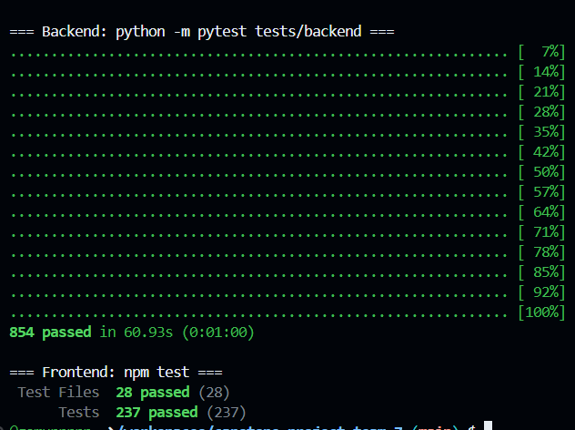
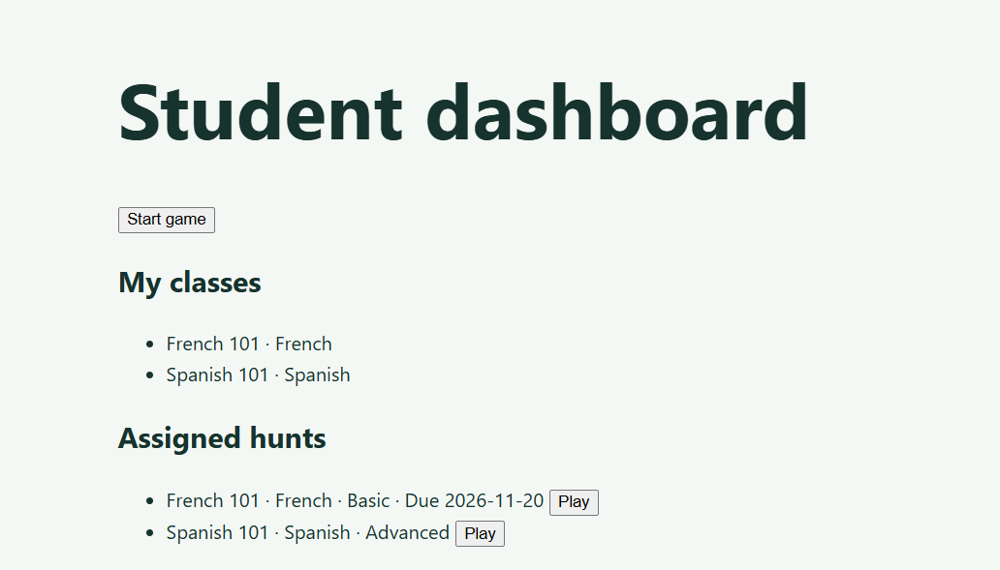
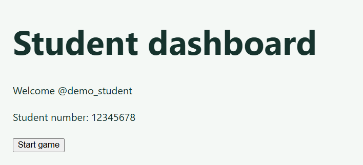
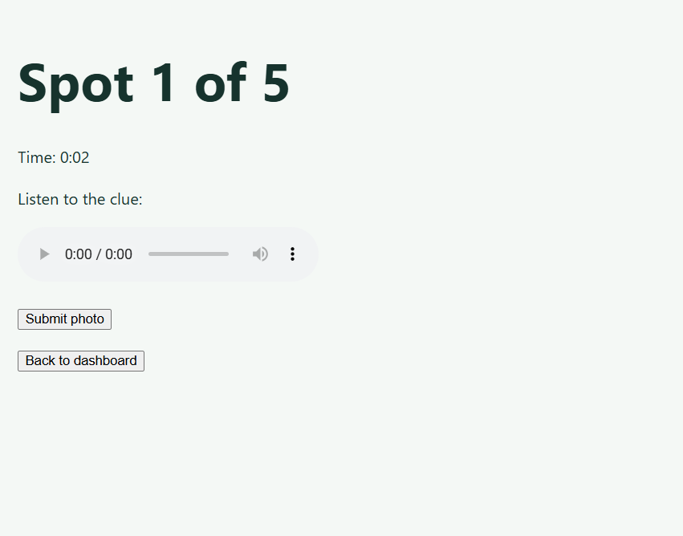
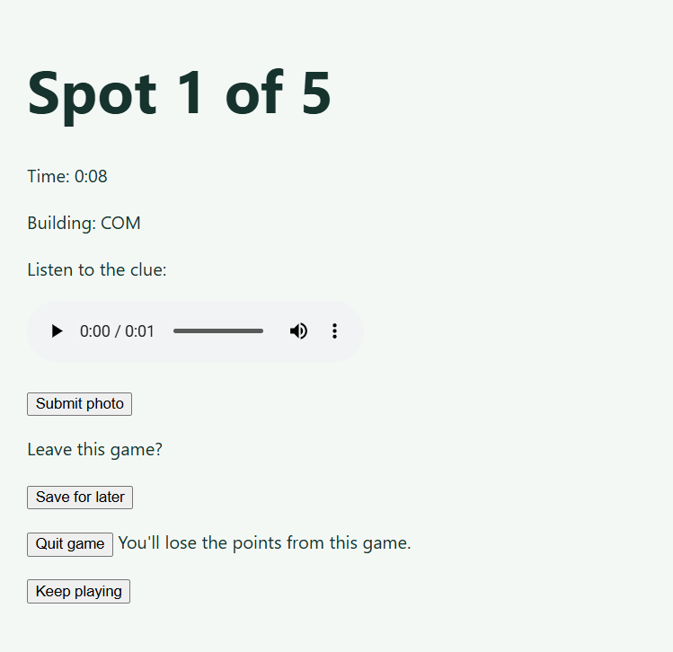
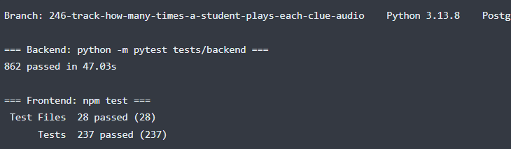
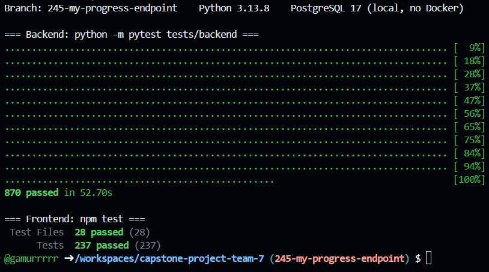
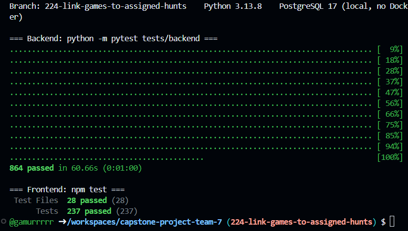

# Week 10–11 Individual Log: Gamu

Team 7 | Repo: capstone-project-team-7 | PRs these two weeks: #223 (assigned hunts on the student dashboard), #227 (refactor: dead code, password limit, badge rename, OCR fixes), #240 (student details on the dashboard), #243 (building only on Basic), #244 (save for later or quit a game), #248 (count clue listens) and #249 ("My progress" details), all merged into main; and #257 (link games to assigned hunts), open and waiting for review.

Week 10 (November 9–15) was reading week, so it was a bonus week with no sprint tasks. I used it to finish the student side of assigned hunts, so students can see and play the hunts their teacher assigned, and to work through my rows of our refactor plan. That included tracking down why photo recognition (OCR) only worked for some of us. Week 11 (November 16–22) is demo prep for Milestone 1, so I picked up three small issues that make the demo game feel finished: showing the student who they're logged in as, hiding the building on Advanced and Expert, and letting students quit a game instead of leaving it in progress forever. After those merged, I started on the backend for the client's progress tracking: counting how many times a student plays each clue, a "My progress" endpoint with their game history and hardest locations, and linking games to assigned hunts so teachers can see who completed them. Like the other demo pages, I kept the frontend plain on purpose, since the team agreed to finish the working features first and style everything later in Milestone 2.

CI note: GitHub Actions is still locked by the billing issue from Nov 5 ("The job was not started because your account is locked due to a billing issue"), so every CI run on every branch fails after 2 seconds without running a test. For each PR I list the test results from my own machine instead.

---

## PR #223: Assigned hunts on the student dashboard (branch `195-demo-frontend-students-dashboard`, into `main`), merged

**Size:** 4 files changed, +168 / -1 lines (`src/frontend/src/components/AssignedHunts.tsx` and `tests/frontend/studentHunts.test.ts` added; `src/frontend/src/api/assignHunt.ts` and `src/frontend/src/pages/StudentDashboard.tsx` updated).

- Teachers could assign hunts to a class (my #165 and #196), and the student endpoint `GET /api/student/hunts` already existed, but nothing in the app showed students their hunts (task #195).
- Therefore, I added an **Assigned hunts** list under "My classes" on the student dashboard. Each line shows the class, language, difficulty and due date, e.g. "French 101 · French · Basic · Due 2026-11-20", with a **Play** button that starts a game with that hunt's language and difficulty and opens the game screen, the same way Start game does.

**Review receipts**

- Before writing any code I checked what already existed. The student endpoint was already merged and tested in #165, so this only needed a frontend PR, not a backend one too.
- Hunts past their due date are hidden, and hunts with no due date always show. With nothing to show, the list says "No assigned hunts right now."
- Play reuses the dashboard's existing `run()` and `startGame()`, so it gets the same busy state, error messages and logout on 401 as Start game, and the Play buttons are disabled while a game is starting.
- Play starts a normal game with the hunt's settings. Games aren't linked to the hunt yet, so teachers can't see who finished an assigned hunt. That needs a migration, a change to the start endpoint and a new teacher endpoint, so it would be its own backend PR and was too big to add here.

**Architecture receipts**

- I reused my `hideOverdue` from the teacher side (#204) instead of copying it. It now accepts any list of hunts that have a `due_date`, so the teacher list and the student list share one function.
- `AssignedHunts.tsx` copies the look and structure of Ashish's `OngoingGames.tsx` (#171), so the two lists on the dashboard match.
- In `StudentDashboard.tsx` I only added 6 lines: two imports, one state, one line in `loadClasses()` (so joining a class also refreshes the hunts) and the list itself.
- No new data flows: the dashboard reads the existing assigned hunts process, and Play uses the existing start game process.

**Clean Code Check**

- The component is 38 lines with one small `huntLabel` helper, and the api function is 10 lines. No new libraries.

**Testing receipts**

- `studentHunts.test.ts` (8 tests): fetching uses the right URL; a 401 throws `SessionEndedError`; a 503 and a network failure show a friendly message; each line shows the right text with and without a due date; past-due hunts are hidden and hunts with no due date show; the empty message shows; clicking Play passes the right hunt; and Play buttons are disabled while busy.
- The tests fake the backend's replies. Clicking Play and opening the game screen was checked by hand in the browser.
- Regression (locally): 207 frontend tests and 445 backend tests passed, and type checking and the build pass. CI couldn't run because of the billing lock.

screenshot of tests passing: 

*Local test run on `main` after #223 and #227 merged (no Docker, real PostgreSQL 17): 854 backend and 237 frontend tests passed.*

**Screenshots**

*Assigned hunts under My classes, each with a Play button. A hunt that was already past its due date is hidden.*

## PR #227: Refactor: dead code, password limit, Polyglot rename and OCR fixes (branch `225-refactor-removing-dead-code-adding-ocr-library-renaming-badge`, into `main`), merged

**Size:** 9 files changed, +20 / -51 lines (`src/backend/routes/admin_reassign.py` and `src/backend/routes/__init__.py` deleted; `src/backend/utils/passwords.py`, `src/backend/auth.py`, `src/backend/badges.py`, `src/backend/Dockerfile`, `tests/backend/test_badges.py`, `tests/backend/test_ocr.py` and `README.md` updated). One commit per change, so each can be reviewed on its own.

- **Dead code:** `routes/admin_reassign.py` was my early placeholder for reassigning classes from week 3. It was never added to the app (`main.py` never included it), its `require_admin()` let everyone through, and `admin.py` now does the real reassigning, so I deleted it and its empty `routes/` folder.
- **Password limit:** `MAX_PASSWORD_BYTES = 72` now lives in `utils/passwords.py` with the other password rules, and `validate_password` uses it instead of a typed-in `72`.
- **Badge rename:** the Polyglot badge is now called "Polyglot Legend", to match the badge picture.
- **OCR in Docker on Windows and Intel/AMD machines:** every photo answer returned 503 "Photo recognition is unavailable" for teammates on Windows, while it worked on Apple-chip Macs. The backend image now installs `libgomp1`.
- **OCR tests on Windows:** two OCR tests crashed on Windows, so I gave their inputs short names.

**Review receipts**

- `auth.py` (Ashish's file) already imports from `passwords.py`, so `passwords.py` couldn't import the constant from `auth.py` without a circular import. I moved the constant into `passwords.py` and changed 2 lines in `auth.py` to import it from there. Everything that does `from auth import MAX_PASSWORD_BYTES` still works.
- The badge rename only changes the name. The id stays `polyglot`, and `student_badges` only saves ids, so badges students already earned still match. The frontend finds the badge by id, so it kept working.
- The OCR problem took the most digging. The issue said to add a missing library to `requirements-ocr.txt`, so first I checked every Python package the OCR code needs: I installed only that file in a fresh environment and the OCR read a test image correctly, so nothing Python was missing. The real error was hidden by the catch-all in `utils/ocr.py`: `ImportError: libgomp.so.1`. Paddle's x86 Linux build needs `libgomp` (a Linux system library), the slim Python image doesn't include it, and Paddle's ARM build (what Docker uses on Apple-chip Macs) doesn't need it, which is why it only broke for some of us. Since it's a system package, it goes in the Dockerfile's `apt-get install` line, not in `requirements-ocr.txt`.
- The Windows test crash was because one test input is a 5 MB fake photo, and pytest used it as part of the test's name. pytest stores that name in an environment variable, and Windows caps those at 32,767 characters. 

**Architecture receipts**

- No new data flows. Deleting the placeholder removes a route that was never reachable, and the password limit is now in one place

**Clean Code Check**

- The PR removes more than it adds (+20 / -51). Each commit has one purpose.

**Testing receipts**

- New `test_polyglot_is_named_polyglot_legend_and_keeps_its_saved_id`: the badge is named "Polyglot Legend" and its id is still `polyglot`. It doesn't need a database, so it always runs.
- The OCR fix was checked on Windows (x86) in Docker after rebuilding the backend: an image reading "LIB 312" gives `['LIB 312']`, and a blank image gives `[]` instead of 503. Before the fix, the same check failed with the `libgomp.so.1` error.
- Regression (locally): 446 backend tests and 199 frontend tests passed. CI couldn't run because of the billing lock.

screenshots of tests passing:

*The same local test run on `main` after #223 and #227 merged: 854 backend and 237 frontend tests passed.*

## PR #240: Student details on the dashboard (branch `239-student-details-on-dashboard`, into `main`), merged

**Size:** 6 files changed, +82 / -7 lines (`tests/frontend/studentDetails.test.ts` added; `src/backend/student_profile.py`, `src/frontend/src/api/profile.ts`, `src/frontend/src/pages/StudentDashboard.tsx`, `tests/backend/test_student_profile.py` and `docs/design/student-profile.md` updated).

- When a student logged in, nothing on the dashboard showed which account they were on
- Therefore, `GET /api/student/profile` now also returns the student's `student_number`, and the dashboard shows "Welcome @username" and "Student number: …" under the heading.

**Review receipts**

- Ashish and Madiba approved, and it was merged on Nov 19. Ashish liked that the change was small and only shows the logged-in student's own details, and Madiba said it will help a lot when we test the game.
- The dashboard saves the username and number from the `getProfile()` call it already makes for "My classes", so there's no extra request.
- Nothing shows until the profile has loaded. If it fails, nothing wrong or blank shows and the existing error message appears instead.
- `student_profile.py` was written by Dan and Ashish, so I only changed 2 lines: the SELECT and the response.
- Dan's original test checked that `student_number` is never returned. Issue #239 changes that on purpose, so I changed that one check to verify the number instead, kept the checks that `password` and `email` are never returned, and tagged Dan in the PR so he can check it. A student still only ever sees their own number, because the endpoint only reads the logged-in student's own row.

**Architecture receipts**

- No new data flows: the existing profile process now also reads `student_number` from the `students` table it already joins.

**Clean Code Check**

- The dashboard change is one state and one small `welcomeText` helper. The helper lets the welcome text be tested without a browser.

**Testing receipts**

- `test_student_profile.py` (2 new tests and 1 updated): the response includes the right `student_number`; a logged-out request gets 401 with no student details; and the real-database test checks the student's own number while `password` and `email` stay hidden. I also checked that the new test fails without the backend change.
- `studentDetails.test.ts` (3 tests): `getProfile()` returns the username and student number; the welcome text is "Welcome @username"; and the dashboard shows no name or number before the profile has loaded.
- Regression (locally): `test_student_profile.py` 15 passed, and 231 frontend tests passed. CI couldn't run because of the billing lock.

screenshots of tests passing:

**Screenshots**

*The dashboard greets the student with "Welcome @demo_student" and shows their student number under the heading.*

## PR #243: Only show the clue's building on Basic (branch `241-demo-prep-remove-building-hint-for-advanced-and-expert-levels`, into `main`), merged

**Size:** 5 files changed, +75 / -4 lines (`tests/backend/test_clue_building.py` added; `src/backend/game_session.py`, `src/frontend/src/api/clue.ts`, `src/frontend/src/pages/GameScreen.tsx` and `README.md` updated).

- Every clue showed the building, on every difficulty. Basic only tests numbers, so the building is fine there, but on Advanced and Expert it gave away half the answer
- Therefore, the clue only sends `building` on Basic. On Advanced and Expert it's `null` and the game screen hides the "Building:" line, so students have to work out where to go from the clue itself.

**Review receipts**

- Ashish and Madiba approved, and it was merged on Nov 19. Ashish pointed out that `test_clue_building.py` rebuilds some test setup that other test files already have. I kept a small copy on purpose, so this test file doesn't depend on another one, but moving the shared setup into one place (like the `conftest.py` from my #177) would be a good refactor for Milestone 2.
- The check uses the `Difficulty` enum that's already imported (`location["difficulty"] == Difficulty.BASIC`), not a typed-in `"basic"`.
- Only `current_clue()` changed. The photo check still uses the real building to match the room photo.
- Before changing anything I checked whether any existing test expected a building on a non-Basic game. None did: the clue test in `test_game_session.py` starts a Basic game, so it didn't need to change.

**Architecture receipts**

- No new data flows: the clue process still reads the same location, it just leaves the building out of the response for Advanced and Expert.

**Clean Code Check**

- The backend change is one line plus a one-line comment, and the frontend change is one line each in `clue.ts` and `GameScreen.tsx`. The tests are in a new file, because `test_game_session.py` is already over 500 lines.

**Testing receipts**

- `test_clue_building.py` (3 tests): a Basic clue includes the building, and Advanced and Expert clues have none. They use a real database in a temporary schema, with their own small setup copied from `test_game_session.py`'s pattern instead of importing its fixtures.
- I also checked the rule by calling `current_clue()` with each difficulty: Basic gives `'EME'`, and Advanced and Expert give `None`.
- Regression (locally): 228 frontend tests passed, `clue.test.ts` included, and type checking and the build pass. CI couldn't run because of the billing lock.

screenshots of tests passing:

**Screenshots**

*An Advanced game: the clue shows the spot, stopwatch and audio, but no "Building:" line.*

## PR #244: Save for later or quit when leaving a game (branch `242-demo-prep-ask-save-for-later-or-quit-when-leaving-a-game`, into `main`), merged

**Size:** 9 files changed, +254 / -10 lines (`src/backend/migrations/013_quit_games.sql`, `tests/backend/test_quit_game.py` and `tests/frontend/quitGame.test.ts` added; `src/backend/game_session.py`, `src/backend/icon_store.py`, `src/frontend/src/api/game.ts`, `src/frontend/src/pages/GameScreen.tsx`, `tests/backend/test_icon_store.py` and `tests/backend/test_answer_check.py` updated).

- "Back to dashboard" on the game screen left the game in progress forever, so unfinished games piled up under Ongoing games (task #242). I first suggested a "quit game" button in my review of Ashish's Resume PR (#171), and this is that follow-up.
- Therefore, clicking **Back to dashboard** now asks what to do: **Save for later** (keep the game under Resume, like before), **Quit game** (end it for good, with "You'll lose the points from this game." next to it) or **Keep playing** (close the question).
- On the backend I added `POST /api/game/{game_id}/quit` and a new `quit_at` column.

**Review receipts**

- Ashish and Madiba approved, and it was merged on Nov 19. Ashish found the **Keep playing** button confusing at first, since a student could also just tap Submit photo to carry on. I agreed, and suggested that in Milestone 2 the three choices become a pop-up, so it's clearer what each button does. Madiba agreed we'll come back to it in M2.
- A quit game isn't deleted. It's marked with `quit_at` and its points are set to 0 in one UPDATE, only for the student's own game that isn't finished or already quit. A missing or another student's game gives 404 "Game not found", the same as the other game endpoints, and an already finished or quit game gives 409.
- A quit game doesn't count as finished, so it's left out of badges and the leaderboard, which already only use finished games. It also disappears from Ongoing games and can't be played or answered (409 "This game was quit").
- **Store change:** the store balance used to add up points from every game, including unfinished ones. A student could have spent points from an unfinished game and then quit it, which resets its points to 0, and ended up with a negative balance. So `icon_store.py` (my #205) now only counts points from finished games. It's one line plus a comment, and I called it out in the PR.
- Two existing tests had to change, and I flagged both before changing them: the `add_games()` helper in my `test_icon_store.py` now saves finished games, since the store tests relied on unfinished games counting; and the fake game row in Dan's `test_answer_check.py` now includes `quit_at`, because it's a hand-made copy of the real database row.

**Architecture receipts**

- The migration is a new numbered file (`013`); I checked that no other branch already used that number.
- The quit endpoint reuses `require_student` and `database_unavailable()` like the other game endpoints, and the frontend `quitGame()` copies the style of `startGame()`.
- `GameScreen.tsx` uses three small pieces of state (`leaving`, `quitting`, `quitError`), and `App.tsx` didn't need to change.
- In the DFD, the new quit process reads and writes `game_sessions` for the student's own game, and the store process now only reads finished games from it.

**Clean Code Check**

- The app code is about 85 lines. The PR is over our 200-line target because of the tests (`test_quit_game.py` is 125 lines), but well under the 500-line limit. The quit tests are in a new file, because `test_game_session.py` is already over 500 lines.

**Testing receipts**

- `test_quit_game.py` (6 tests): quitting removes the game from Ongoing; a quit game's clue gives 409; quitting sets the points to 0 and doesn't finish the game; a game can't be quit twice; another student's game gives 404 and its points are untouched; and a logged-out user gets 401 and a teacher gets 403.
- New store test: a finished game's points count toward the balance, but an unfinished or quit game's don't.
- `quitGame.test.ts` (4 tests): the right URL and method; 401 throws `SessionEndedError`; 409 says "This game has already ended"; and other failures show a friendly message.
- Locally, 787 backend passed, 232 frontend tests passed.
- I also ran the real backend and frontend against a demo database and checked it by hand: Save for later keeps the game under Resume, Quit game removes it from Ongoing games, and Keep playing closes the question. CI couldn't run because of the billing lock.

screenshots of tests passing:

**Screenshots**

*After clicking Back to dashboard: Save for later, Quit game (with "You'll lose the points from this game.") and Keep playing.*

## PR #248: Count clue listens (branch `246-track-how-many-times-a-student-plays-each-clue-audio`, into `main`), merged

**Size:** 5 files changed, +192 / -2 lines (`src/backend/game_listens.py`, `src/backend/migrations/014_clue_listens.sql` and `tests/backend/test_game_listens.py` added; `src/backend/main.py` and `README.md` updated).

- The client wants to know which locations are hardest, and the student's "My progress" stats need it too, but nothing recorded how many times a student played each clue's audio (task #246).
- Therefore, each spot in a game now has a `listens` count (starting at 0), and `POST /api/game/{game_id}/listen` adds 1 to the current spot's count. The frontend will call it each time the student presses play, which is a separate issue.

**Review receipts**

- It counts presses of play with its own call, not audio downloads, because browsers can download the same audio more than once.
- The count goes up in one UPDATE inside the database (`listens = listens + 1`), so two plays at the same moment are both counted. I tested this by sending 20 plays at the same moment: the count came out at exactly 20.
- Only the student who owns the game can count a listen. Another student's game or a missing one gives 404 "Game not found", like the other game endpoints, and a finished or quit game gives 409.
- I also updated the README for this endpoint and for quitting games (#244), which hadn't been documented yet.

**Architecture receipts**

- I reused the existing `require_student` check, `current_location()` from `game_session.py` (for the 404 and 409 checks) and `database_unavailable()`, instead of writing new checks.
- The new route file sits in `src/backend/` next to the other route files. I didn't use a `routes/` folder, since my #227 removed that folder as dead code.
- In the DFD, the new listen process writes the `listens` count in `game_session_locations` for the student's own current spot.

**Clean Code Check**

- The endpoint is 38 lines with one UPDATE, and every query uses `%s` placeholders.

**Testing receipts**

- `test_game_listens.py` (8 tests): new spots start at 0; three plays count as 3; only the current spot goes up; another student's game gives 404 and nothing is counted; a finished game gives 409; logged out gives 401; a teacher gets 403; and a database failure gives 503.
- Without Docker, I set up a local PostgreSQL 17 and a Python 3.13 environment with the OCR packages, so the whole backend suite runs, including the database and OCR tests: 862 backend and 237 frontend tests passed. CI couldn't run because of the billing lock.

screenshots of tests passing:

*Local test run for #248 (no Docker, real PostgreSQL 17): 862 backend and 237 frontend tests passed.*

## PR #249: "My progress" details endpoint (branch `245-my-progress-endpoint`, into `main`), merged

**Size:** 4 files changed, +210 lines on top of #248 (`src/backend/student_progress.py` and `tests/backend/test_student_progress.py` added; `src/backend/main.py` and `README.md` updated). It builds on #248 for the `listens` count, so #248 was merged first.

- The "My progress" page needs the student's full history, and there was no endpoint for it (task #245).
- Therefore, I added `GET /api/student/progress/details`. It returns the student's total points and games finished; every finished game, newest first, with the date, language, difficulty, points and time taken; their fastest and slowest game; their top 3 hardest locations by listens; and their games and points for each language.

**Review receipts**

- Only finished games count. Unfinished and quit games are left out.
- Hardest locations are sorted by listens, a tie goes to the location with more photo attempts, and locations with 0 listens are left out.
- Hardest locations also only count finished games. If they counted an unfinished game, its building and room number could give away the answer to a clue the student hasn't found yet.
- The endpoint returns plain numbers and names only, and the frontend will write the sentences.
- A student with no finished games gets zeros, empty lists and `null` for fastest and slowest, not an error.

**Architecture receipts**

- It reuses `require_student` and `database_unavailable()`. It's two queries (games, and hardest locations), and the totals, fastest and slowest game, and per-language numbers are worked out in Python from the games list, so there's no extra query.
- In the DFD, the progress process reads `game_sessions`, `game_session_locations` and `locations` for the signed-in student only.

**Clean Code Check**

- The endpoint is 57 lines. The PR's own code and tests came to 199 lines, just under our 200-line target, after I merged a few tests that checked the same data.

**Testing receipts**

- `test_student_progress.py` (8 tests): games are newest first with the right fields; only my own finished games count; fastest and slowest game are right; the top 3 hardest locations are in the right order with 0-listen locations left out; a tie goes to more attempts (named so alphabetical order would give the wrong answer); total and per-language totals are right; a student with no finished games gets zeros, empty lists and nulls; and logged out gives 401 and a teacher gets 403.
- Regression (locally, real PostgreSQL 17): 870 backend and 237 frontend tests passed. CI couldn't run because of the billing lock.

screenshots of tests passing:

*Local test run for #249: 870 backend and 237 frontend tests passed.*

## PR #257: Link games to assigned hunts and show hunt completion (branch `224-link-games-to-assigned-hunts-2`, into `main`), open, not merged yet

My code, first opened as my PR #250. Ashish accidentally pushed a branch that built on my work straight to main, so GitHub marked #250 as merged and closed it. He reverted the push in #256 and cherry-picked my code, unchanged, into #257, which is why GitHub shows him as the author.

**Size:** 8 files changed, +260 / -6 lines (`src/backend/hunt_progress.py`, `src/backend/migrations/015_hunt_games.sql` and `tests/backend/test_hunt_progress.py` added; `src/backend/game_session.py`, `src/backend/student_hunts.py`, `src/backend/main.py`, `tests/backend/test_student_hunts.py` and `README.md` updated).

- Play on an assigned hunt (#223) started a normal game, so teachers couldn't see which students completed a hunt (task #224).
- Therefore, games can now be linked to a hunt with a new `hunt_id`. Students start a hunt with `POST /api/student/hunts/{hunt_id}/start`. Teachers see every enrolled student's status (completed, in progress or not started), best points and fastest time with `GET /api/teacher/hunts/{hunt_id}/completion`, and the student's hunt list now says whether each hunt is completed.

**Review receipts**

- Starting a hunt checks the student is enrolled in the hunt's class, then uses the hunt's own language and difficulty, so a student can't change them.
- Only the teacher who owns the hunt's class can see its completion. Another teacher's hunt gives 404.
- Quit games never count as completed or in progress.
- Teachers can still delete a hunt that has games: the link is `ON DELETE SET NULL`, so the games are kept but no longer linked. I checked this with a real database.
- The migration is `015`, because my #248 already uses `014`.
- Dan's `test_start_game_choices.py` checks the exact values sent when a game is saved. Instead of changing his test, I kept the normal start game exactly as before, and only a hunt game runs one extra update (in the same transaction) to save its `hunt_id`.
- This PR is backend only, so it's "Part of #224". The Play button change is ready as a small follow-up PR, and a teacher screen for completion is still to do.

**Architecture receipts**

- To reuse the start-game code instead of copying it, I moved the body of `start_game` (which I wrote in week 7) into a plain `create_game()` function. The normal Start game calls it without a hunt, and the new hunt endpoint calls it with one.
- It reuses `require_student`, `teacher_connection`, `owned_class()` and `database_unavailable()`, so there are no new session or ownership checks.
- In the DFD, starting a hunt reads `assigned_hunts` and `class_enrollments`, then writes `game_sessions` with the hunt. The completion process reads `assigned_hunts`, `classes`, `class_enrollments` and `game_sessions`.

**Clean Code Check**

- The new file is 58 lines and the change to `game_session.py` is 10 lines. I kept the PR under 10 files by moving the frontend change into its own follow-up PR.

**Testing receipts**

- `test_hunt_progress.py` (10 tests): starting a hunt saves `hunt_id` and the hunt's settings; a normal start game has no `hunt_id`; a student not in the class gets 404; the teacher sees all three statuses; best points and fastest time across replays; a quit game doesn't count; another teacher gets 404; the student's `completed` flag goes from false to true; another student's finish doesn't count for me; and 401 and 403 on both endpoints.
- `test_student_hunts.py`: the one test that compares the whole response now expects `completed`.
- Regression (locally, real PostgreSQL 17): 864 backend and 237 frontend tests passed. CI couldn't run because of the billing lock.

screenshots of tests passing:

*Local test run for #257 (run on #250, same code): 864 backend and 237 frontend tests passed.*

## Code reviews for teammates

These are some of my reviews on teammates' PRs these two weeks.

**PR #202: Teachers view locations and upload clue audio (Ashish)**

- I requested changes last week because a teacher's upload replaces the audio for every class that uses that location, including the client's recordings. Ashish explained that audio isn't linked to classes in the database yet, so per-class audio needs its own PR once difficulty-based audio and audio management are built, with per-class audio as a follow-up.

**PR #228: Teacher dashboard form to upload clue audio (Ashish)**

- I approved, and asked whether it's okay for now that any teacher can overwrite another teacher's clip and lose the original generated audio, or whether we should keep a backup or store clips per class later. Ashish confirmed it's the same known limit from #202 and will change when per-class audio is added.

**PR #238: Default profile icon (Ashish)**

- I approved. A default icon looks more finished than an empty space, and it answers the question I raised in my #198 review about what new students should show.

**PR #252: Upload clue audio for each difficulty (Ashish)**

- I ran it locally (the backend `test_audio_storage` and `test_teacher_locations` tests and the frontend `clueAudio` tests all passed, and `tsc` was clean) and liked the "Has Basic · Missing Advanced, Expert" status. I pointed out that the Basic/Advanced/Expert list is now copied in both `ClueAudioForm` and `AssignHuntForm` and could be shared, and asked again about per-class uploads. Ashish replied that per-class audio needs a new table to map several clips to one location and pick the right one for each hunt, so he wants the diagrams and database design worked out first.

**PR #254: Teachers add locations (Ashish)**

- I requested changes. Latitude and longitude should be required, because a room without GPS never gets picked and there's no way to add GPS later. I also asked for a `base_game` column on `location_clues`, false for teacher-added clues, so badges can ignore teacher locations. Ashish made both changes (422 without GPS, and migration 016), and I approved. Dan then asked for the badge filter in this PR too, so Ashish added it there instead of me doing it in a follow-up.

**PR #261: Directional clues for Advanced and story clues for Expert (Dan)**

- I liked that LIB 312 and 317 finally have different clues, but requested changes because 10 MP3s in `fr/advanced` and `fr/expert` were committed for local testing and pushed the PR to 14 files, over our under-10 rule. I asked Dan to remove them and add those folders to `.gitignore`. I also noted that the Advanced and Expert scripts only live in `seed_locations.py`, so teacher-added locations will need them stored in the database later.

**PR #263: Skip and replace the current hunt location (Dan)**

- I approved, and pointed out that once my #248 merged, the skip UPDATE should also reset `listens` to 0 like it does attempts. Otherwise the skipped room's listens carry over to the new room and teacher reports will be off.
