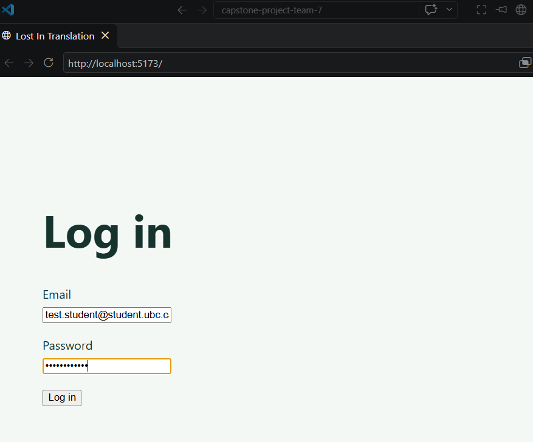
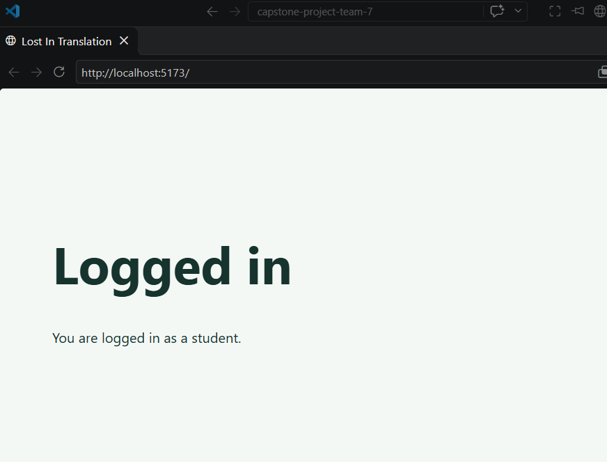
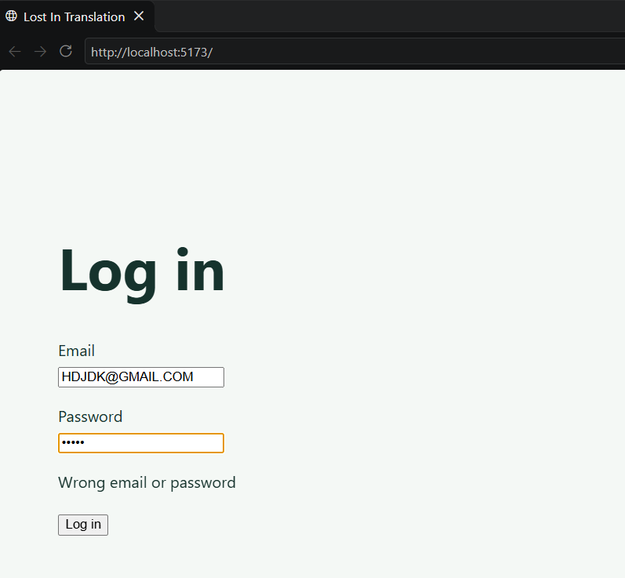
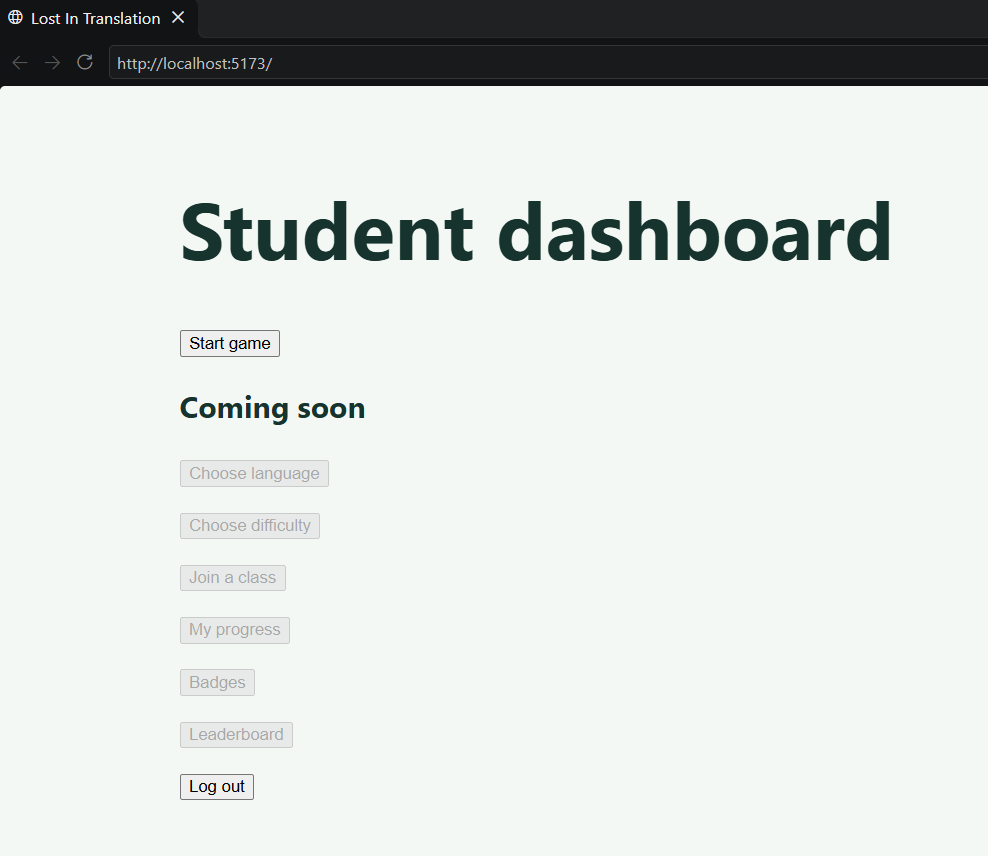
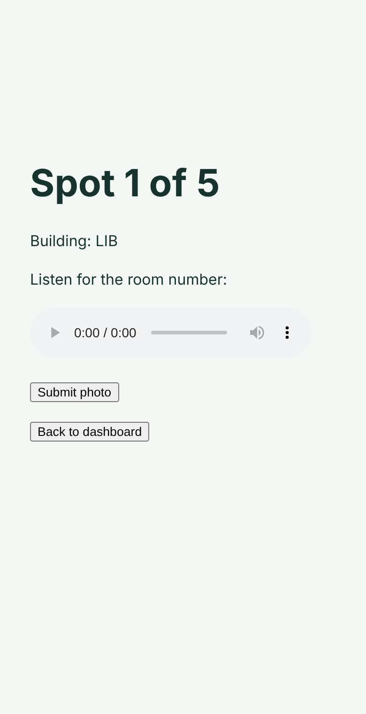
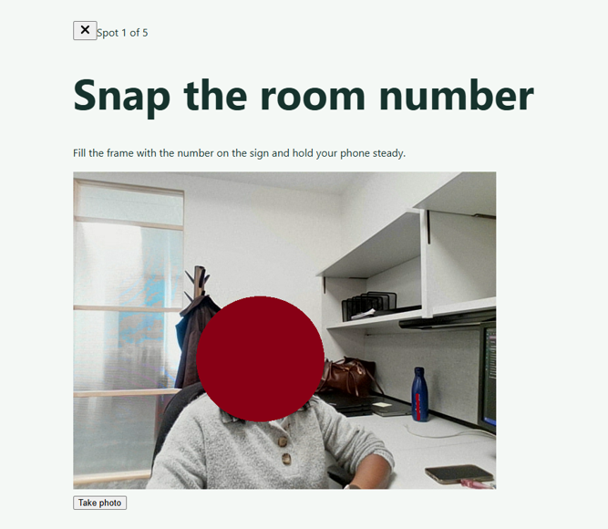

# Week 7 Individual Log: Gamu

Team 7 | Repo: capstone-project-team-7 | PRs this week: #117 (basic login page); #120 (start game endpoint), #121 (basic student dashboard), #123 (demo locations and French audio clues), #125 (current clue and audio endpoints), #127 (basic game screen), #129 (submit answer endpoint) and #132 (photo page connected to the game) all merged into main

This week the team's goal was a bare-minimum game session working from start to finish for the demo: log in, start a game, hear a clue, take a photo, move to the next spot. I built the student side of that flow, both the backend endpoints and the plain clickable screens. The demo game is always French on Basic difficulty for now, so students skip choosing a language and difficulty.

Several of my PRs build on each other (for example the game screen needs the dashboard, which needs the login page).
---

## PR #117: Basic login page connected to the backend (branch `116-basic-login-page`, into `main`)

**Size:** 7 files changed, +213 / -17 lines (`src/frontend/src/pages/LoginPage.tsx`, `src/frontend/src/api/login.ts` and `src/frontend/src/api/currentUser.ts` added, `src/frontend/src/App.tsx` updated, `tests/frontend/login.test.ts`, `tests/frontend/currentUser.test.ts` and `tests/frontend/tsconfig.json` added).

- Every part of the game needs a logged-in student, so the first screen of the demo is a login page (task #116).
- Therefore, I built a plain login form that sends the email and password to the existing `POST /api/auth/login` endpoint (#44). The backend sets a login cookie, and `App.tsx` shows the right screen for the user's role. On page load, `App.tsx` also asks `GET /api/auth/me` (#57) whether the cookie is still valid, so refreshing the page doesn't log the user out.

**Review receipts**

- Ashish and Dan approved. Ashish pointed out that refreshing the page sent the user back to the login screen, and logging in again created an extra session row in the database each time. He said it could wait for a later PR, but it was a small fix, so I added the logged-in check (`currentUser.ts`) in this PR instead.
- The page is intentionally plain. The team agreed to get the game working end to end first
- A wrong email or password shows "Wrong email or password", and any other problem shows a general message, so the page never shows raw server errors.

**Architecture receipts**

- The frontend talks to the backend only through small files in `src/frontend/src/api/`, one per endpoint. Pages call these files and never call `fetch` themselves, so if an endpoint changes, only one file needs updating.
- In the DFD, this is the student's first data flow: email and password go to the backend login process, which checks the `users` table in PostgreSQL and creates a row in `sessions`. The cookie it returns is what every later game request uses to know who the student is.
- I didn't change any backend code. `tests/frontend/tsconfig.json` lets the frontend tests in `tests/` find Vitest inside `src/frontend/`, since our tests live outside the frontend folder.

**Clean Code Check**

- I re-read the files for hardcoded values, duplicate code, dead code and deep nesting. Each file has one job, and all are well under 500 lines.

**Testing receipts**

- `login.test.ts` (4 tests): sends the email and password to the right endpoint, returns the role on success, shows a clear message for a wrong password (401), and a general message for server problems.
- `currentUser.test.ts` (4 tests): a valid cookie returns the user, and no login, a server problem or a network failure all return nobody, so the login page still shows instead of the app crashing.
- The tests fake the backend's replies, so they run anywhere, including CI.
- Regression: the full frontend suite passed. Frontend CI run: [CI Run](https://github.com/COSC-499-W2026/capstone-project-team-7/actions/runs/40031101779/job/120679266637)
Backend CI run: [CI Run](https://github.com/COSC-499-W2026/capstone-project-team-7/actions/runs/40031101779/job/120679266840)

**Screenshots**

## PR #120: Start game endpoint (branch `119-start-game-backend-endpoint`, into `main`)

**Size:** 5 files changed, +230 / -0 lines (`src/backend/game_session.py` added, `src/backend/migrations/005_game_sessions.sql` added, `tests/backend/test_game_session.py` added, `src/backend/main.py` updated with 2 lines, `README.md` updated with a new section).

- A game needs to be saved somewhere so the app knows which locations the student got and where they are up to (task #119).
- Therefore, I implemented `POST /api/game/start`. It picks 5 random locations using Ashish's picker (#108), saves the game and its 5 locations in order, and returns 201 with the game id, language, difficulty, current spot and total spots.
- The new migration adds two tables: `game_sessions` (one row per game) and `game_session_locations` (the 5 spots in order, with how many attempts each took and when it was found).

**Review receipts**

- The response never includes the locations, so a student can't open the browser's network tab and see the answers.
- Only locations that have a French clue are picked, so a student never gets a blank clue. If there aren't 5, the endpoint returns 409 "Not enough locations for this language yet" instead of starting a broken game.
- Attempts are saved now, even though points come later, because the team agreed that each retry will lower the points a spot is worth.
- If a student account is deleted, their games are kept (the student id is set to empty instead of deleting the game). This is so teachers don't lose class records, which the team is still discussing.
- I reused Ashish's `pick_locations` and `require_student`, Dan's `Difficulty` from #88, and `database_unavailable`. I didn't edit their code.

**Architecture receipts**

- `game_session.py` is a new FastAPI router in `src/backend/`, the same style as the other routers. The only existing code file I touched is `main.py` (2 lines).
- In the DFD, this is the start of the new "game session" process. The student's request carries their login cookie, `require_student` checks it, the process reads `location_clues`, and writes to `game_sessions` and `game_session_locations` in PostgreSQL.
- The language and difficulty are set in one place at the top of the file (`LANGUAGE = "fr"`, `DIFFICULTY = Difficulty.BASIC`), so adding language and difficulty choice later only means replacing those two lines with values from the request.

**Clean Code Check**

- I re-read the file and tests for hardcoded values, duplicate code, dead code, deep nesting and unrelated responsibilities. The French/Basic values are on purpose for the demo and are labelled with a comment. This PR is a little over our 200-line target, mostly because of the migration and tests.

**Testing receipts**

- Happy path: `test_student_starts_game` confirms a 201 and that 5 different locations are saved in order.
- Negative cases: `test_locations_without_french_clue_are_never_picked`, `test_too_few_locations_returns_conflict` (409), `test_start_requires_student` (no login gives 401, teachers and admins get 403) and `test_start_database_failure_is_safe` (503).
- `test_deleting_student_keeps_game` confirms the game is kept when the student is deleted.
- The tests use a real PostgreSQL database in a temporary schema and are skipped if `TEST_DATABASE_URL` is not set. 8 tests in `tests/backend/test_game_session.py`.
- Regression: the full backend suite passed. Backend CI run: [CI Run](https://github.com/COSC-499-W2026/capstone-project-team-7/actions/runs/40019863668/job/120641284387?pr=120)

## PR #121: Basic student dashboard (branch `118-basic-student-dashboard`, into `main`)

**Size:** 5 files changed, +162 / -1 lines (`src/frontend/src/pages/StudentDashboard.tsx`, `src/frontend/src/api/game.ts` and `src/frontend/src/api/logout.ts` added, `src/frontend/src/App.tsx` updated, `tests/frontend/dashboard.test.ts` added).

- After logging in, a student needs somewhere to start a game from (task #118).
- Therefore, I built a bare-bones dashboard where only **Start game** and **Log out** work. Start game calls my endpoint from #120, and Log out calls the existing `POST /api/auth/logout` (#37).

**Review receipts**

- Future features (choose language, choose difficulty, join a class, progress, badges, leaderboard) show as greyed-out "Coming soon" buttons, so the dashboard layout is clear for the demo without pretending those features work.
- If the session had already ended, Log out still logs the user out instead of showing an error, since the end result is the same.
- Both buttons are disabled while a request is running, so a double tap can't start two games.

**Architecture receipts**

- Same pattern as the login page: the page calls `api/game.ts` and `api/logout.ts`, which call the backend. `App.tsx` decides which screen to show.
- In the DFD, the dashboard is where the student's "start game" request enters the game session process.

**Clean Code Check**

- The "Coming soon" buttons come from one list, not six copies of the same button. Files are well under 500 lines.

**Testing receipts**

- `dashboard.test.ts` (7 tests): start game calls the right endpoint and returns the game; clear messages for not enough locations (409), an ended session (401) and server problems; logout calls the right endpoint, still works if the session already ended, and shows a message for server problems.
- Regression: the full frontend suite passed. Frontend CI run: [CI Run](https://github.com/COSC-499-W2026/capstone-project-team-7/actions/runs/40031441280/job/120680387125?pr=121)

**Screenshots**

## PR #123: Demo locations and French audio clues (branch `122-demo-locations`, into `main`)

**Size:** 9 files changed, +142 / -0 lines (`src/backend/utils/seed_locations.py` and `src/backend/utils/generate_audio.py` added, 5 audio files added in `src/backend/audio/fr/`, `tests/backend/test_seed_locations.py` and `tests/backend/test_generate_audio.py` added). The 5 audio files are binary, so they add no lines.

- The game can't run without real locations and clues in the database. Dan's #92 added the tables, so I added the data for the demo.
- Therefore, `seed_locations.py` adds 5 campus rooms (COM 316, LIB 312, ASC 130, LIB 317, ART 376) and their French clues. It's safe to run more than once: anything that already exists is skipped.
- `generate_audio.py` makes one French audio file per room using a free text-to-speech voice. On Basic difficulty the building is shown on screen and only the room number is spoken, so the audio says just the number (e.g. "trois cent seize").

**Review receipts**

- The audio is AI-generated and temporary. The client will give us real recordings later, and they can replace these files without any code changes as long as the names stay the same.
- I chose saved audio files over the browser reading text out loud, because they sound more natural and are the same on every phone.
- The audio is kept in the backend, not the public website folder, because the file names contain the room numbers. Students only ever get the audio through the game API (#125).
- I wrote down each room's GPS coordinates in the script but don't save them yet, because the locations table has no coordinate columns until Dan's GPS work adds them. This way nobody has to look them up again.

**Architecture receipts**

- Both scripts are under `src/backend/utils/`, as the PR rules allow, and are run by hand once, not by the app.
- In the DFD, the seed script is a one-time setup flow that writes into the `locations` and `location_clues` data stores, which the game session process later reads.

**Clean Code Check**

- Both scripts are short (51 and 34 lines). The audio files are named by building and room (not by database id), because ids are different in every database.
- One thing to fix later: `test_seed_locations.py` borrows a test setup from `test_seed_admin.py`. Shared test setup should move into one `conftest.py` file in a later refactor PR.

**Testing receipts**

- `test_seed_locations.py` (4 tests): 5 different rooms with French text, every location gets a French clue, running it twice adds nothing new, and a location that already exists still gets its missing clue. These use a temporary database schema, so they never touch real data.
- `test_generate_audio.py` (3 tests): files are named by building and room, every demo location gets its own file, and the audio is saved in the backend, not the public website.
- Regression: the full backend suite passed. Backend CI run: [CI Run](https://github.com/COSC-499-W2026/capstone-project-team-7/actions/runs/40020063749/job/120641985444?pr=123)

## PR #125: Current clue and clue audio endpoints (branch `124-get-audio-endpoint`, into `main`)

**Size:** 3 files changed, +170 / -0 lines (`src/backend/game_session.py` updated, `tests/backend/test_game_session.py` updated, `README.md` updated).

- Once a game starts, the student needs to see which building to go to and hear the room number (task #124).
- Therefore, I added `GET /api/game/{game_id}/clue`, which returns the spot number, total spots, the building and an audio link, and `GET /api/game/{game_id}/clue/audio`, which plays the audio for the current spot.

**Review receipts**

- The room number is never sent as text, and the audio link doesn't contain it either, so the student has to listen.
- Asking for another student's game gives the same 404 as a game that doesn't exist, so students can't peek at other games.
- A finished game gives 409, and a missing audio file gives 404 instead of crashing.
- Both endpoints share one `current_location` helper, so the "which spot is this student on?" logic is written once.

**Architecture receipts**

- These live in the same `game_session.py` router as #120. No new files and no changes to other people's code.
- In the DFD, the game session process reads `game_sessions`, `game_session_locations` and `locations`, sends the building to the student, and streams the matching audio file from the backend's audio folder.

**Clean Code Check**

- I re-read for duplicates and dead code. `game_session.py` is under 200 lines 

**Testing receipts**

- Happy path: `test_student_gets_first_clue_without_the_room_number`, `test_clue_audio_plays_the_current_rooms_file` and `test_clue_follows_current_position`.
- Negative cases: missing audio file (404), another student's game (404 for both the clue and the audio), finished game (409), not a student (401/403), invalid game id (422), and database failure (503).
- 11 new tests in `tests/backend/test_game_session.py`.
- Regression: the full backend suite passed. Backend CI run: [CI Run](https://github.com/COSC-499-W2026/capstone-project-team-7/actions/runs/40021429769/job/120646674477?pr=125)

## PR #127: Basic game screen (branch `126-basic-game-session-screen`, into `main`)

**Size:** 4 files changed, +131 / -5 lines (`src/frontend/src/pages/GameScreen.tsx` and `src/frontend/src/api/clue.ts` added, `src/frontend/src/App.tsx` updated, `tests/frontend/clue.test.ts` added).

- After pressing Start game, the student needs to see their clue (task #126).
- Therefore, the game screen shows "Spot 1 of 5", the building, an audio player for the clue from #125, and a **Submit photo** button below it.

**Review receipts**

- If the student leaves the screen before the clue loads, the screen doesn't try to update itself afterwards, which avoids a common React warning.
- Errors (ended login, game not found, game finished) show a message with a button back to the dashboard, so the student is never stuck.

**Architecture receipts**

- Same pattern again: `GameScreen.tsx` calls `api/clue.ts`, and `App.tsx` switches between dashboard, game and photo screens.

**Clean Code Check**

- One file per screen and per endpoint, each under 60 lines.

**Testing receipts**

- `clue.test.ts` (5 tests): gets the clue for the right game, and shows clear messages for an ended login (401), a missing game (404), a finished game (409) and server problems.
- Regression: the full frontend suite passed. Frontend CI run: [CI Run](https://github.com/COSC-499-W2026/capstone-project-team-7/actions/runs/40031512374/job/120680620257?pr=127)

**Screenshots**

## PR #129: Submit answer endpoint (branch `128-submit-answer-endpoint`, into `main`)

**Size:** 5 files changed, +150 / -1 lines (`src/backend/game_session.py` updated, `src/backend/utils/answer_check.py` added, `tests/backend/test_game_session.py` updated, `tests/backend/test_answer_check.py` added, `README.md` updated).

- The student needs to send their photo so the game can move to the next spot (task #128).
- Therefore, I added `POST /api/game/{game_id}/answer`. It takes the photo, counts the attempt, and if the answer is right, moves to the next spot. After the 5th correct answer it marks the game as finished.

**Review receipts**

- The real answer check (reading the room number from the photo, and checking GPS) is Madiba's OCR work and Dan's GPS work. So `check_answer` in `answer_check.py` temporarily counts every photo as correct. When their work is ready, only that one function changes. The endpoint stays the same.
- If the same answer is sent twice (e.g. a double tap), the game only moves forward once, and the second one gets 409.
- Wrong answers stay on the same spot and still count as an attempt, ready for the points system.
- An empty photo gives 422 and a photo over 10 MB gives 413.

**Architecture receipts**

- In the DFD, the photo goes from the student to the game session process, which passes it to the answer check (later OCR and GPS), then updates `game_sessions` and `game_session_locations`.
- Keeping the check in its own file means the OCR and GPS work can plug in without anyone editing the endpoint, which also keeps us from editing each other's code.

**Clean Code Check**

- The temporary always-correct check is clearly labelled in its comment so nobody mistakes it for the final version.
- One thing to fix later: `game_session.py` imports `database_unavailable` from `teacher_access.py`, so the game code depends on the teacher code. That helper should move into one shared file in a later refactor PR.

**Testing receipts**

- Happy path: `test_correct_answer_moves_to_next_spot` and `test_fifth_correct_answer_finishes_game`.
- Negative cases: wrong answer stays on the spot and counts attempts, no photo (422), photo too large (413), another student's game (404), not a student (401/403), and database failure (503).
- `test_answer_check.py` confirms the temporary check. 11 new tests in total.
- Regression: the full backend suite passed. Backend CI run: [CI Run](https://github.com/COSC-499-W2026/capstone-project-team-7/actions/runs/40031512374/job/120680620257?pr=127)

## PR #132: Photo page connected to the game (branch `130-basic-photo-page-submit-and-completion-screen`, into `main`)

**Size:** 3 files changed, +193 / -6 lines (`src/frontend/src/pages/PhotoSubmitPage.tsx` added, `src/frontend/src/App.tsx` updated, `tests/frontend/PhotoSubmitPage.test.ts` added).

- Pressing **Submit photo** on the game screen needs to open the camera (task #130).
- Therefore, i made the photo page and connected it to the game screen. It shows which spot the photo is for, opens the phone's back camera, and lets the student take, retake and submit a photo.

**Review receipts**

- Only the live camera is used, with no "choose from library" option, so students can't upload an old photo. This is a game rule the team agreed on to make cheating harder.
- The camera turns off when the student leaves the page or takes a photo, so it doesn't keep running in the background.
- Camera problems show clear messages: blocked camera access explains why we need it, and a device with no camera says so.
- Actually sending the photo to the backend is done in Ashish's #133, which builds on this PR. I kept them separate so each PR stays small.

**Architecture receipts**

- In the DFD, this page is where the photo data flow starts on the student's phone, before it goes to the answer endpoint (#129).

**Clean Code Check**

- The camera error messages are worked out in one small function, which made them easy to test on their own. The page is 149 lines, under 500.

**Testing receipts**

- `PhotoSubmitPage.test.ts` (5 tests): shows the live camera and no file picker, the take-photo button waits until the camera is ready, and clear messages for blocked access, no camera, and other camera problems.
- Regression: the full frontend suite passed. Frontend CI run: [CI Run](https://github.com/COSC-499-W2026/capstone-project-team-7/actions/runs/40036815645/job/120698224338?pr=132)

**Screenshots**

## Code reviews for teammates

**PR #108: Random location picker (Ashish)**

- I approved, and all 8 tests passed for me. The picker just takes a list and picks 5, which made it easy to plug into my start game endpoint (#120). I suggested the comment say it takes location ids, not full rows, which Ashish updated. I also flagged that, after our discussion, every location has audio and hints in each language.

**PR #114: Teacher class roster (Ashish)**

- I approved. It reuses the existing teacher and class-ownership checks, doesn't return emails or passwords, and another teacher's class gives 404 for privacy. I noted that if we change removing students to keep their data, the roster will need to show only students still in the class.