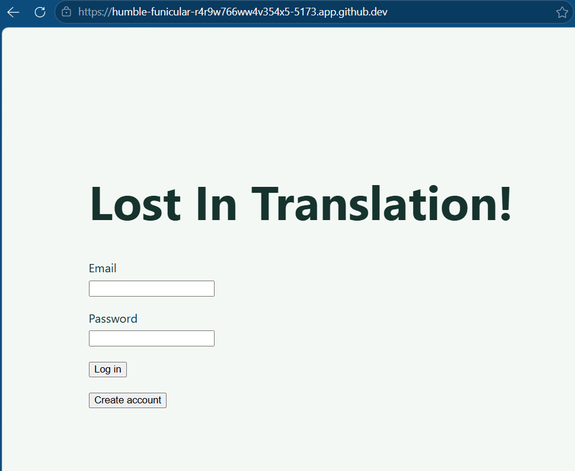
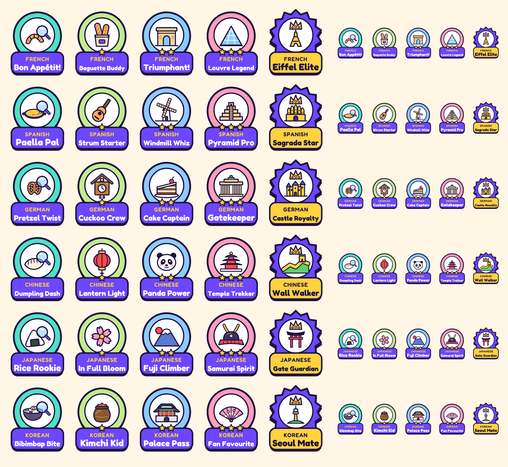
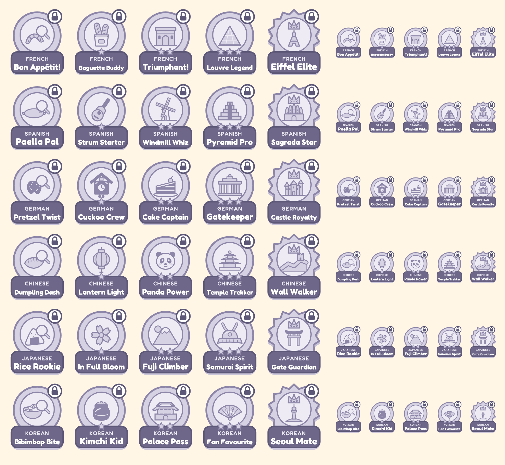
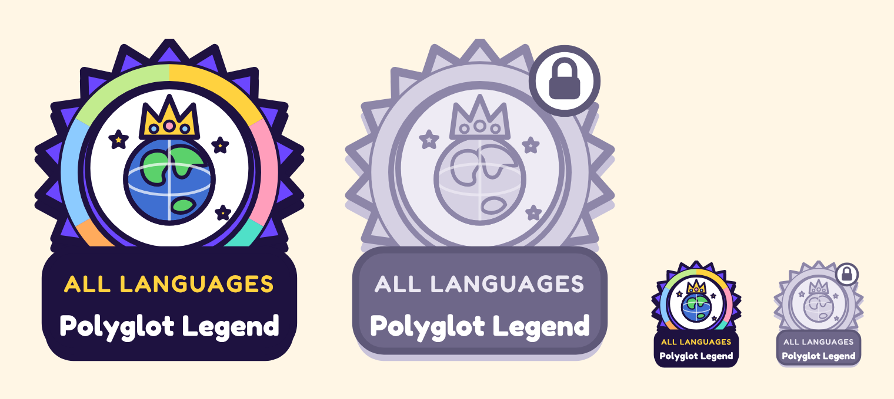

# Week 8 Individual Log: Gamu

Team 7 | Repo: capstone-project-team-7 | PRs this week: #___ (create account page), #___ (badge rules), #___ (badges endpoint) and #___ (teacher-assigned hunts) all merged into main

Last week we got a basic game session working from start to finish. This week I added the pieces around the game: a way for new students to make an account from the app, language-specific badges that are earned while playing, and a way for teachers to assign hunts to their classes. I kept the frontend plain on purpose, since the team agreed to finish the working features first and style everything later in Milestone 2.

While building the create account page I noticed a security problem with teacher signup (explained under the first PR), so I raised it with the team instead of trying to fix it in my own PR, because that code belongs to a teammate.

---

## PR #___: Create account page (branch `159-demo-frontend-create-account-page`, into `main`)

**Size:** 5 files changed, +250 / -3 lines (`src/frontend/src/pages/CreateAccountPage.tsx` and `src/frontend/src/api/signup.ts` added, `src/frontend/src/App.tsx` and `src/frontend/src/pages/LoginPage.tsx` updated, `tests/frontend/createAccount.test.ts` added).

- Up to now the only way to get a student account was to call the backend directly, so new students couldn't sign up from the app (task #159, Milestone 2 requirement #107).
- Therefore, I added a **Create account** button to the login page that opens a simple signup form. The form sends the student's details to the existing student signup endpoint (`POST /api/auth/student/signup`, Madiba's #66), then logs the new student in automatically so they land straight on their dashboard.

**Review receipts**

- Reviewed by ___.
- The page is for students only. While testing I noticed the form asks for a student number, which teachers don't have. Teachers sign up through a separate endpoint that only checks their email is on the approved teacher list. Teacher emails are usually public, so a student could sign up with a teacher's email before the teacher does and get a teacher account. I raised this with the team and suggested that admins create teacher accounts and teachers set their own password through Forgot Password (#96), which proves they own the email or send out a verification link to the email to activate the account. This is a team decision since it changes Dan's teacher signup, so I didn't change the backend in this PR.
- After a successful signup, the student is logged in automatically and goes straight to their dashboard, so they don't have to type their details twice. If the account is created but the automatic login fails, they're sent to the login page with "Account created! Please log in.", so they're never stuck. If signup itself fails, it never tries to log in.
- If signup fails, the form keeps what the student typed so they don't have to fill it in again, and shows a clear message: already in use (409), password length or invalid email (422), or a general message for anything else. The page never shows raw server errors.

**Architecture receipts**

- Same pattern as my login page (#117): the page calls `api/signup.ts`, and only that file talks to the backend. The automatic login reuses my existing `login()` from `api/login.ts` instead of a second copy of the login code. `App.tsx` decides which screen to show (login, create account, dashboard or game).
- In the DFD, this adds a new data flow: the student's signup details go from the browser to the backend's student signup process, which writes to the `users` and `students` tables in PostgreSQL. The automatic login then goes through the existing login process, which creates a row in `sessions`.
- I didn't change any backend code. On the login page I only added the button, the success message and the game title.

**Clean Code Check**

- The form fields come from one list instead of six copies of the same input, so adding a field later is one line. Files are all well under 500 lines.

**Testing receipts**

- `createAccount.test.ts` (10 tests): sends the details to the right endpoint; clear messages for an email already in use, a short password and server problems; a new account is logged straight in with the same email and password; if the automatic login fails the account is still created; if signup fails it never tries to log in; the login page has a Create account button and shows the "Account created" message; and the create account page asks for every signup field and links back to login.
- The tests fake the backend's replies, so they run anywhere, including CI.
- Regression: the full frontend suite passed. Frontend CI run: [CI Run](___)

**Screenshots**

*The login page with the new Create account button under Log in.*

*The create account form: the six signup fields, the Create account button, and a link back to login.*

*After signing up, the new student is logged straight in to their dashboard.*

## PR #___: Language badge rules (branch `157-language-specific-badges`, into `main`)

**Size:** 3 files changed, +257 / -0 lines (`src/backend/badges.py`, `src/backend/migrations/008_student_badges.sql` and `tests/backend/test_badges.py` added).

- Our proposal includes language-specific badges, so students have something to work towards in each language (task #157).
- Therefore, I added the badge rules and a function that saves any badges a student has earned. Each of the 6 languages has 5 badges, plus one **Polyglot** badge across all languages, for 31 in total:
  - **First hunt**: finish 1 game in that language (e.g. French "Bon Appétit!")
  - **Basic, Advanced, Expert**: find every location that has a clue in that language, at that difficulty (e.g. "Baguette Buddy", "Triumphant!", "Louvre Legend")
  - **Master**: earn all 4 of the above in that language (e.g. "Eiffel Elite")
  - **Polyglot**: earn First hunt in all 6 languages
- The badge names match our badge designs in the "designs" folder under "docs" (also shown below). They're kept in one lookup table (`BADGE_NAMES`), so a name can be changed in one place. 

**Review receipts**

- Reviewed by ___.
- I split badges into two PRs (rules first, then the endpoint) so each one is small and easy to review.
- A location counts toward a difficulty badge if the student found it in any game at that difficulty, even a game they didn't finish. GPS and the photo check both passed, so they really found it. This can't be used to cheat, because the badge needs every location, and it's fairer if a student has to leave a game early. First hunt still needs a finished game, because that badge is about finishing.
- Only locations that have a clue in that language count. Otherwise a student could never earn a badge for a language that doesn't have every clue yet.
- A badge can never be given twice: the table's key is the student and the badge together, and saving uses `ON CONFLICT DO NOTHING`.
- Badges don't depend on points
- Master and Polyglot reuse the existing rules (`all_of` and `in_every_language` combine them) instead of checking the saved badges or writing the checks again, so they always follow the same rules as the other badges.
- Polyglot is hard on purpose (every language), so it's a long-term goal. Only French has clues for now, so nobody can earn it yet, but the tests create locations in all 6 languages so it is fully tested.
- Only the badge names match the designs; the ids stay short and plain (`fr_basic`, `fr_master`, `polyglot`), because earned badges are saved by id and ids must never change. Names can be changed any time.

**Architecture receipts**

- The badges are a simple list in `badges.py`, like Dan's `difficulties.py` (#88). Adding Master and Polyglot was one line each, which proved the design works. Adding a badge later is one new line, with no new code and no migration, because the database only stores the badge's id. This follows the Open/Closed principle.
- In the DFD, the badge process reads the student's progress from `game_sessions`, `game_session_locations` and `location_clues`, and writes earned badges to the new `student_badges` data store.

**Clean Code Check**

- I re-read for hardcoded values, duplicate code, dead code and deep nesting. Each rule is a small function, and the comment above the badge list warns that badge ids must never change, since earned badges are saved by id. `badges.py` is under 100 lines.

**Testing receipts**

- `test_badges.py` (8 tests): finding every Basic French location earns French Basic; finding only some earns nothing; checking twice doesn't give the badge twice; French progress never earns a Spanish badge; Basic and Advanced only doesn't earn French Master, but adding Expert does; and finishing games in 5 languages doesn't earn Polyglot, but all 6 does.
- The negative tests are the "almost there" cases (2 of 3 difficulties, 5 of 6 languages), since that's where a counting mistake would show up.
- These use a real PostgreSQL database in a temporary schema and are skipped if `TEST_DATABASE_URL` isn't set.
- Regression: the full backend suite passed. Backend CI run: [CI Run](___)

**Screenshots**

*All 30 language badges, earned: one row per language with First hunt, Basic (1 star), Advanced (2 stars), Expert (3 stars) and Master (crown), at full and small size.*

*The same 30 badges locked: greyed out with a padlock until the student earns them.*

*The Polyglot badge for all languages, earned and locked, at full and small size.*

## PR #___: Badges endpoint and awarding badges during the game (branch `162-language-specific-badges-endpoint`, into `main`)

**Size:** 7 files changed, +154 / -0 lines on top of the badge rules PR (`src/backend/student_badges.py` and `tests/backend/test_student_badges.py` added; `src/backend/badges.py`, `src/backend/game_session.py`, `src/backend/main.py`, `tests/backend/test_answer_check.py` and `README.md` updated).

- Badges need to be given out automatically while students play, and the frontend needs a way to show them (task #162).
- Therefore, a correct answer now checks the student's progress and saves any new badges. I also added `GET /api/student/badges`, which returns every badge with `id`, `name`, `language`, `earned` and `earned_at`. Polyglot has `language` set to `null`, since it belongs to every language.

**Review receipts**

- Reviewed by ___.
- The endpoint returns all badges, not only earned ones, because the Milestone 2 badges screen shows locked badges greyed out. A brand new student gets every badge back as locked, not an error. The tests count the badge list instead of a fixed number, so adding Master and Polyglot didn't break them.
- Badges are saved in the same database transaction as the answer, so a student's progress and their badges can never get out of step.
- I thought about adding the newly earned badges to the game completion screen. Since the proper frontend comes later, I left it out of this PR to keep it small. The badges are still saved the moment they're earned, so the data will be ready when we build that screen.
- I added one line to `tests/backend/test_answer_check.py` (which Madiba last updated for OCR) so those tests skip the badge check. Without it, those tests would try to reach a real database. No logic in his code changed.

**Architecture receipts**

- `student_badges.py` is a small router that only reads, and all badge logic stays in `badges.py`, so there is one place to change badge rules.
- In my game session code (`game_session.py`) the change is 4 lines: import the function and call it after a correct answer.
- In the DFD, the student's request carries their login cookie, `require_student` checks it, and the badges process reads `student_badges` for that student only. Students can never see anyone else's badges.

**Clean Code Check**

- I re-read for duplicate code and dead code. One thing to fix later: `student_badges.py` imports `database_unavailable` from `teacher_access.py`, so student code depends on teacher code. That helper should move into one shared errors file in a refactor PR.

**Testing receipts**

- `test_student_badges.py` (7 test cases): earned badges are marked earned and the rest locked; a new student gets every badge locked; no login gives 401; teachers and admins get 403; finding the last Basic French location awards French Basic; and finishing a first French game awards French First hunt (with 6 locations, so it can't also earn French Basic by accident).
- The last two tests play a real game through the API, from start to the 5th answer, to make sure badges are awarded at the right moment and not earlier.
- Regression: the full backend suite passed. Backend CI run: [CI Run](___)

## PR #___: Teachers assign hunts to their classes (branch `158-teacher-assign-levels-endpoint`, into `main`)

**Size:** 7 files changed, +285 / -0 lines (`src/backend/hunt_assignment.py`, `src/backend/student_hunts.py`, `src/backend/migrations/009_assigned_hunts.sql`, `tests/backend/test_hunt_assignment.py` and `tests/backend/test_student_hunts.py` added; `src/backend/main.py` and `README.md` updated).

- We thought a cool feature would be teachers being able to assign levels in a specified difficulty to their class while students can still play whatever they want (task #158).
- Therefore, I added `POST /api/teacher/classes/{class_id}/hunts`, where a teacher assigns a hunt (difficulty and an optional due date) to a class they own, and `GET /api/student/hunts`, where a student sees the hunts assigned to the classes they're in, soonest due first.

**Review receipts**

- Reviewed by ___.
- The teacher doesn't pick a language. Every class already has a language (from Ashish's class creation, #76), so the hunt uses the class's language. This means a teacher can't assign a Spanish hunt to a French class by mistake. The language is copied onto the hunt so it stays the same even if the class changes later.
- A due date can't be in the past, and the difficulty must be Basic, Advanced or Expert (Dan's `Difficulty` from #88).
- Assigning the same hunt twice is allowed
- I did both endpoints in one PR. It's over our 200-line target (mostly tests), but well under the 500-line limit.

**Architecture receipts**

- Two small routers in `src/backend/`, the same style as the other endpoints. The teacher one uses `require_teacher` and the student one uses `require_student`, so I reused the existing login and role checks and didn't edit anyone's code.
- In the DFD, the teacher's request goes to the hunt assignment process, which reads `classes` to check ownership and the language, then writes to the new `assigned_hunts` data store. The student's request goes to the assigned hunts process, which reads `assigned_hunts`, `classes` and `class_enrollments`.

**Clean Code Check**

- Both files are under 50 lines. Two things to fix later: both tests borrow test setup from Dan's `test_teacher_access.py`, which should move into one shared `conftest.py` file; and both files import `database_unavailable` from `teacher_access.py` (same issue as the badges endpoint).

**Testing receipts**

- `test_hunt_assignment.py` (15 test cases): a teacher assigns a Basic hunt and it gets the class's language; works with a future due date; the same hunt can be assigned twice; another teacher's class gives 403 and nothing is saved; a missing class gives 404; bad requests (no difficulty, unknown difficulty, trying to send a language, bad date) give 422; a past due date gives 422; no login gives 401, and students and admins get 403; and a database failure gives 503.
- `test_student_hunts.py` (8 test cases): a student sees their class's hunt; a student in two classes sees both; hunts from classes they're not in are hidden; a student with no classes gets an empty list; no login gives 401, and teachers and admins get 403; and a database failure gives 503.
- Every "blocked" test also checks that nothing was saved, not just the error code.
- Regression: the full backend suite passed. Backend CI run: [CI Run](___)

## Code reviews for teammates
