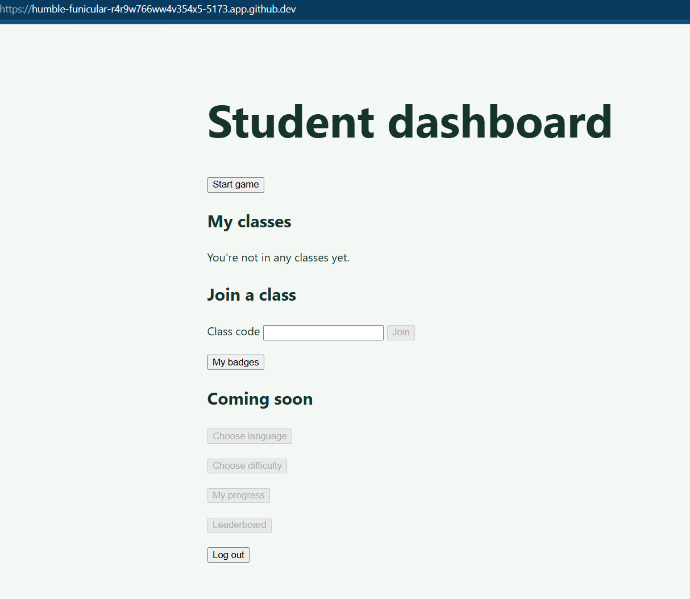
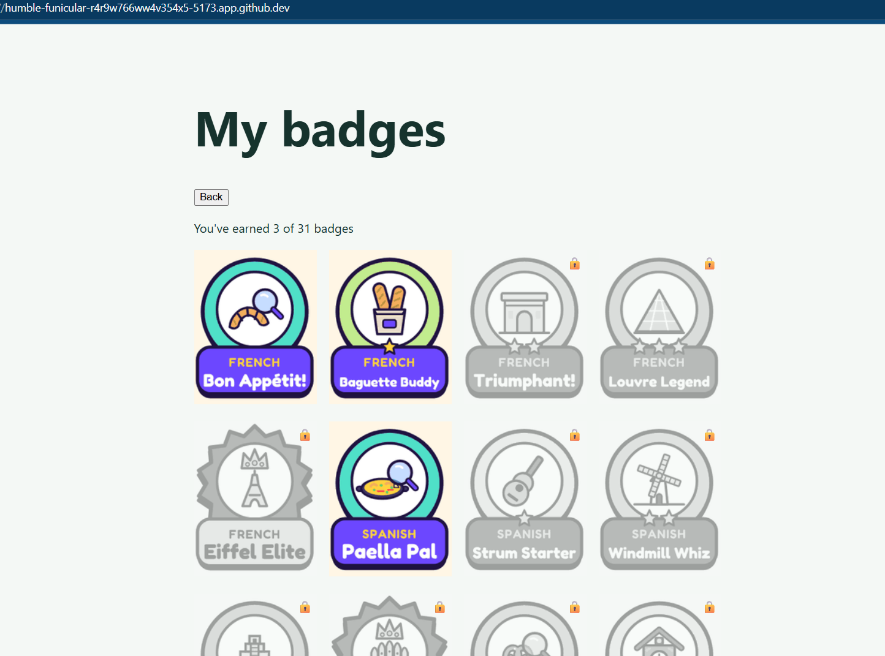
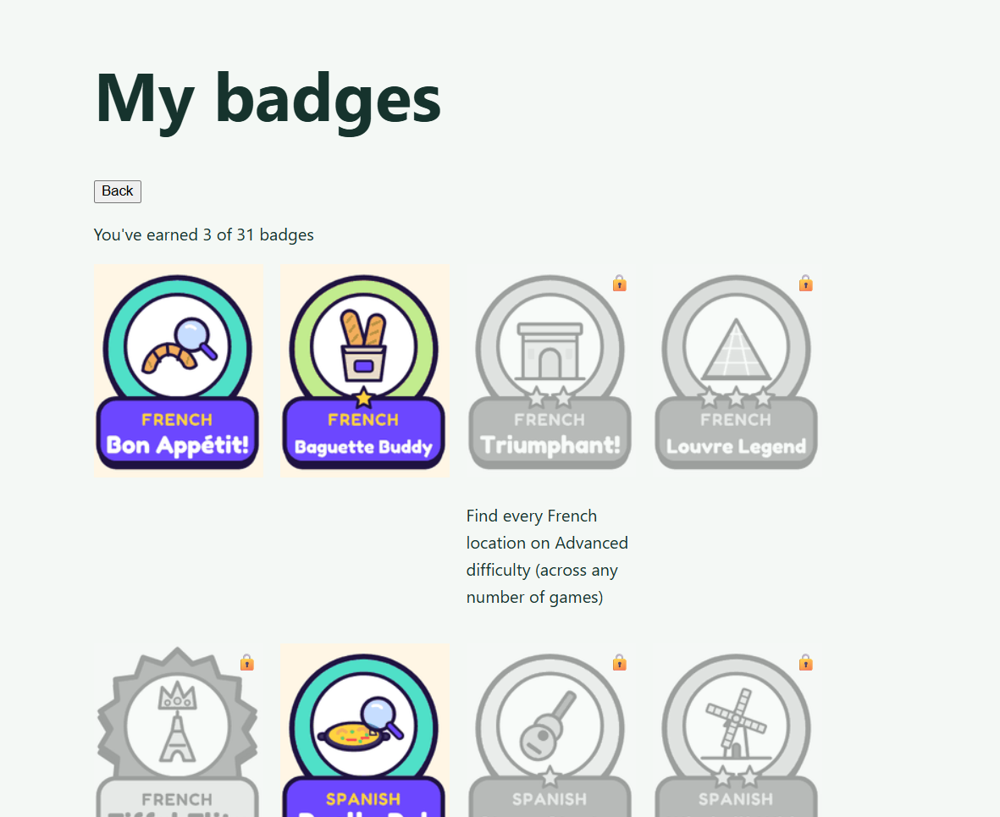
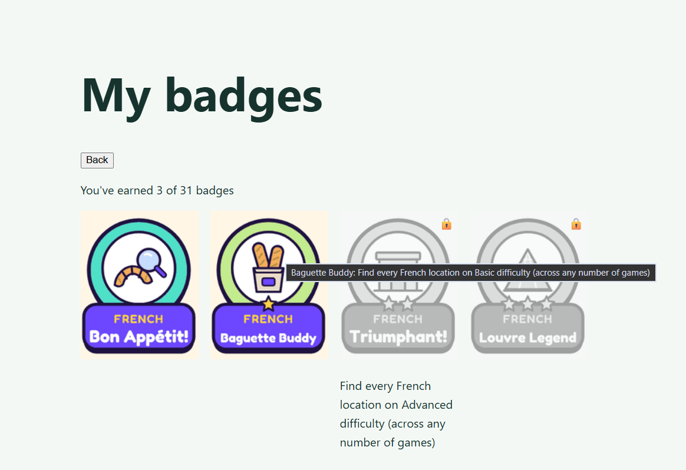
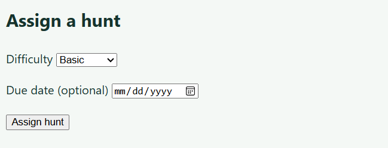
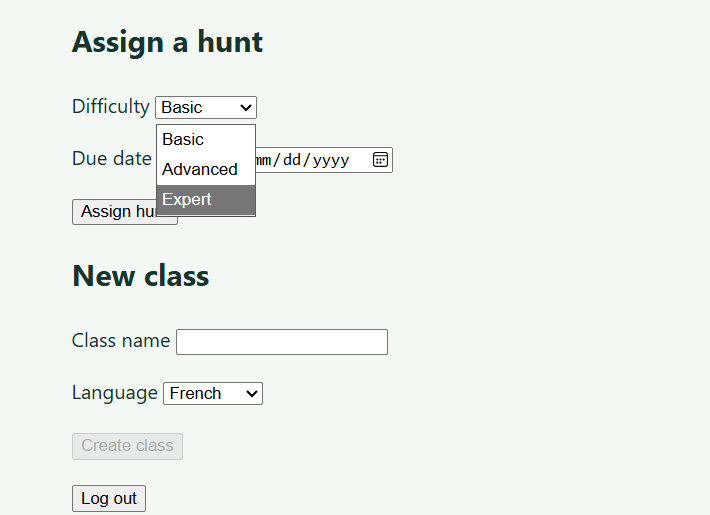
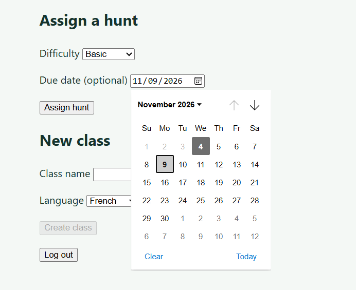
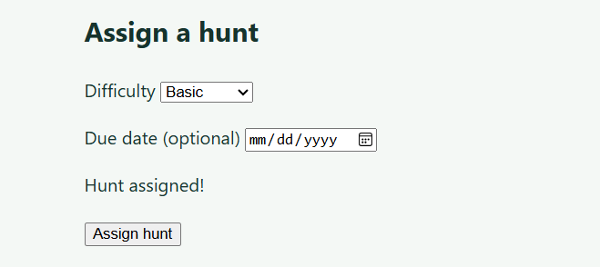

# Week 9 Individual Log: Gamu

Team 7 | Repo: capstone-project-team-7 | PRs this week: #194 (badges page) and #196 (assign hunts form), both open and waiting for review, not merged yet

Last week I added the badge rules and the badges endpoint, but students still had no way to see their badges in the app. This week I added a simple badges page so students can see which badges they've earned, which ones are still locked, and what each one is for. I also started the frontend for last week's teacher-assigned hunts, beginning with the teacher side: a small form on the teacher dashboard to assign a hunt to a class. Like the other demo pages, I kept it plain on purpose, since the team agreed to finish the working features first and style everything later in Milestone 2.

---

## PR #194: Badges page (branch `190-demo-frontend-badges-page`, into `main`), open, not merged yet

**Size:** 7 files changed, +200 / -3 lines (`src/frontend/src/pages/BadgesPage.tsx`, `src/frontend/src/api/badges.ts`, `src/frontend/src/assets/badges.png` and `tests/frontend/badges.test.ts` added; `src/frontend/src/App.tsx`, `src/frontend/src/pages/StudentDashboard.tsx` and `README.md` updated).

- Badges were being earned and saved during games (my #161 and #163), but the student dashboard only had a disabled "Badges" button under "Coming soon", so students couldn't see them (task #190).
- Therefore, I replaced that button with a working **My badges** button. It opens a page that shows every badge in a grid, with "You've earned X of Y badges" at the top. Earned badges are in full colour, and locked badges are greyed out and faded with a lock, matching the badge mockups from last week.
- Hovering over a badge shows its name and what it's for (e.g. French First hunt: "Complete a full game in French on any difficulty"). Clicking or tapping a badge shows the same text under it.

**Review receipts**

- All 31 badge pictures are in one sprite sheet (`badges.png`, 5 columns × 7 rows) instead of 31 separate images, to keep the PR under our file limit. Each badge shows its part of the sheet using CSS `background-position`, and one small helper (`badgeTile`) turns a badge id like `es_advanced` into its row and column.
- A badge that isn't in the sheet (e.g. a language added later, since badges come from the `languages` table) shows a plain box with its name instead of breaking the page.
- I added click/tap as well as hover for the descriptions, because students will mostly use phones during the hunt, and phones can't hover.
- The descriptions are written in the frontend from the badge id, so I didn't need to change the backend. They match the rules in `src/backend/badges.py`
- If the login session has ended (401), the student is sent back to the login page, the same as the other pages.
- The PR is exactly at our 200-line target, so I shortened the tests by grouping related checks rather than going over.

**Architecture receipts**

- Same pattern as my other pages: the page calls `api/badges.ts`, and only that file talks to the backend (copied from the style of `api/profile.ts`). `App.tsx` decides which screen to show, with one new switch for the badges page.
- I reused the existing `SessionEndedError` and the shared `utils/languageName.ts` instead of writing new versions.
- This fits the DFD from last week's badges endpoint, so the diagram doesn't change: the student's request carries their login cookie, `require_student` checks it, and the badges process reads `student_badges` for that student only.
- I didn't change any backend code. In `StudentDashboard.tsx` and `App.tsx` I only added what was needed to open the page.

**Clean Code Check**

- Each helper does one thing: `badgeTile` (id → row and column), `badgeStyle` (colour or grey), `badgeDescription` (what it's for) and `earnedText` (the count). The page is about 100 lines. 

**Testing receipts**

- `badges.test.ts` (6 tests): loads the badge list from the right endpoint; a 401 throws `SessionEndedError` so the app goes to login; other failures show "Could not load your badges"; badge ids point to the right tile (`fr_first_hunt` 0,0, `es_advanced` 1,2, `ko_master` 5,4, `polyglot` 6,0) and an unknown id gets no tile; locked badges are grey and faded but earned ones aren't, and the count is right; and each badge type has the right description.
- The tests fake the backend's replies, so they run anywhere, including CI.
- Clicking a badge to show its description was checked by hand in the browser.
- Regression: the full frontend suite passed (128 tests), and type checking and the build pass. CI run: [CI Run](https://github.com/COSC-499-W2026/capstone-project-team-7/actions/runs/41898997090)

**Screenshots**

*The student dashboard with the new My badges button.*

*The badges page: earned badges in colour, locked badges greyed out with a lock.*

*Clicking a badge shows how it is earned.*

*Hovering over a badge also shows how it is earned.*

## PR #196: Teacher assigns hunts to a class (branch `191-demo-frontend-teacher-assigned-hunts`, into `main`), open, not merged yet

**Size:** 4 files changed, +145 / -0 lines (`src/frontend/src/api/assignHunt.ts`, `src/frontend/src/components/AssignHuntForm.tsx` and `tests/frontend/assignHunt.test.ts` added; `src/frontend/src/pages/TeacherDashboard.tsx` updated).

- Last week I added the endpoint for teachers to assign hunts to their classes (#165), but teachers had no way to use it from the app (task #191).
- Therefore, I added an **Assign a hunt** form under the class roster on the teacher dashboard, for whichever class the teacher has selected. The teacher picks a difficulty (Basic, Advanced or Expert) and an optional due date, then clicks **Assign hunt**. On success it shows "Hunt assigned!" and resets the form.
- This PR is the teacher side only. Students seeing their assigned hunts will be a separate PR, so each one stays small.

**Review receipts**

- The form doesn't ask for a language, because the backend uses the class's language automatically. A teacher can't assign a Spanish hunt to a French class by mistake.
- The date picker greys out past days. The backend also rejects past dates (422), and the form shows "Due date can't be in the past" if one gets through.
- Leaving the due date empty sends `null`, which means the hunt has no due date.
- Errors have friendly messages: another teacher's class or a missing class (403/404) shows "You can't assign hunts to this class", and anything else, including no connection, shows "Could not assign the hunt, please try again". If the login session has ended (401), the teacher is sent back to the login page.
- The button is disabled and says "Assigning hunt..." while it's sending, so a hunt can't be assigned twice by double-clicking.
- Each class gets a fresh form, so switching class clears the old message.

**Architecture receipts**

- I made a new `api/assignHunt.ts` instead of adding to `api/teacher.ts`. That file's shared helper turns every 403 into "Teacher access required", and changing it would have meant editing a teammate's code.
- The form copies the style of Madiba's `CreateClassForm.tsx`, and reuses the existing `SessionEndedError`.
- In `TeacherDashboard.tsx` (Madiba's file) I only added 2 lines: the import and the form next to `ClassRoster`.
- This fits the DFD from last week's hunt assignment endpoint, so the diagram doesn't change: the teacher's request goes to the hunt assignment process, which checks the class belongs to them and writes to `assigned_hunts`.
- I didn't change any backend code.

**Clean Code Check**

- The api file only talks to the backend and the form only handles what the teacher sees, so each has one job. All files are under 70 lines.

**Testing receipts**

- `assignHunt.test.ts` (9 tests): sends the right URL and body and returns the hunt; an empty due date is sent as `null`; a 401 throws `SessionEndedError`; 422, 403, 404 and 503 each show the right message; a network failure shows the friendly message; and the form has three difficulties, an optional due date and an Assign hunt button.
- The tests fake the backend's replies, so they run anywhere, including CI.
- Regression: the full frontend suite passed (131 tests), and type checking and the build pass. CI run: [CI Run](https://github.com/COSC-499-W2026/capstone-project-team-7/actions/runs/41902889336)

**Screenshots**

*The Assign a hunt form on the teacher dashboard for the selected class.*

*The teacher picks a difficulty. The language comes from the class automatically.*

*The optional due date. The browser's calendar greys out past dates.*

*The success message after assigning a hunt.*

## Code reviews for teammates

