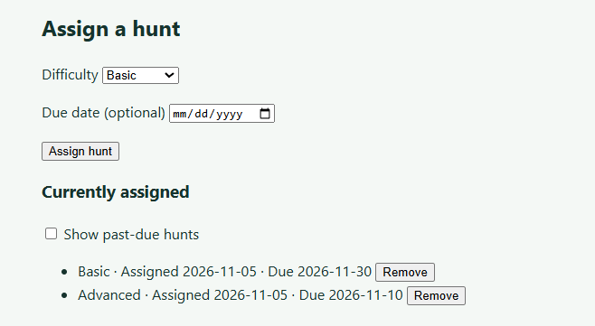
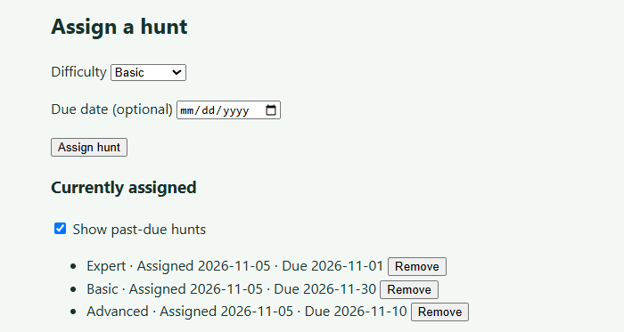
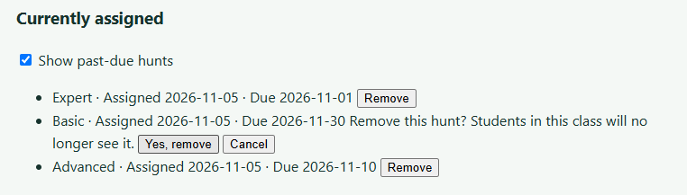
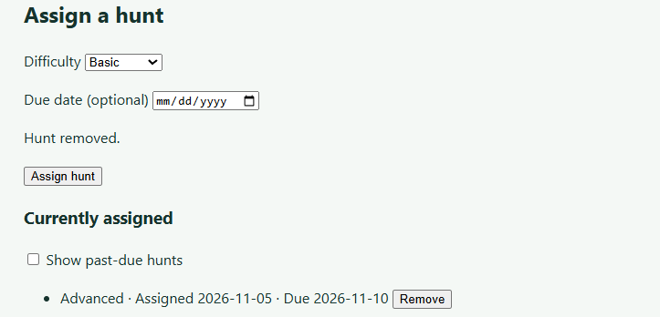
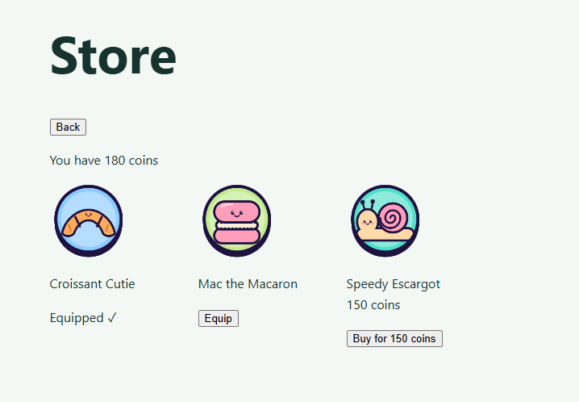

# Week 9 Individual Log: Gamu

Team 7 | Repo: capstone-project-team-7 | PRs this week: #194 (badges page), #196 (assign hunts form) and #204 (list and remove assigned hunts), open and waiting for review; #205 (redeem points endpoints, draft) and #206 (icon store page, draft). None are merged yet.

Last week I added the badge rules and the badges endpoint, but students still had no way to see their badges in the app. This week I added a simple badges page so students can see which badges they've earned, which ones are still locked, and what each one is for. I also built the frontend for last week's teacher-assigned hunts: a small form on the teacher dashboard to assign a hunt to a class, and a list under it where teachers can see and remove the hunts they've assigned. Finally, I started on points: students can now spend the points they earn in games on profile icons, with a backend for redeeming and a store page. Like the other demo pages, I kept it plain on purpose, since the team agreed to finish the working features first and style everything later in Milestone 2.

Some of these PRs build on PRs that aren't merged yet (mine and Ashish's), so the sizes below are what each PR will show once the PRs it builds on are merged. Until then, GitHub also counts those other PRs' changes.

CI note: since Nov 5, GitHub Actions hasn't run any jobs for our repo ("The job was not started because your account is locked due to a billing issue"), so every CI run this week shows as failed after 3 seconds without running a single test, on every branch. For those PRs I list the test results from my own machine instead.

---

## PR #194: Badges page (branch `190-demo-frontend-badges-page`, into `main`), open, not merged yet

**Size:** 7 files changed, +200 / -3 lines (`src/frontend/src/pages/BadgesPage.tsx`, `src/frontend/src/api/badges.ts`, `src/frontend/src/assets/badges.png` and `tests/frontend/badges.test.ts` added; `src/frontend/src/App.tsx`, `src/frontend/src/pages/StudentDashboard.tsx` and `README.md` updated).

- Badges were being earned and saved during games (my #161 and #163), but the student dashboard only had a disabled "Badges" button under "Coming soon", so students couldn't see them (task #190).
- Therefore, I replaced that button with a working **My badges** button. It opens a page that shows every badge in a grid, with "You've earned X of Y badges" at the top. Earned badges are in full colour, and locked badges are greyed out and faded with a lock, matching the badge mockups from last week.
- Hovering over a badge shows its name and what it's for (e.g. French First hunt: "Complete a full game in French on any difficulty"). Clicking or tapping a badge shows the same text under it.

**Review receipts**

- All 31 badge pictures are in one sprite sheet (`badges.png`, 5 columns × 7 rows) instead of 31 separate images, to keep the PR under our file limit. Each badge shows its part of the sheet using CSS `background-position`, and one small helper (`badgeTile`) turns a badge id like `es_advanced` into its row and column.
- A badge that isn't in the sheet (e.g. a language added later, since badges come from the `languages` table) shows a plain box with its name instead of breaking the page.
- I added click/tap as well as hover for the descriptions, because students will mostly use phones during the hunt, and phones can't hover.
- The descriptions are written in the frontend from the badge id, so I didn't need to change the backend. They match the rules in `src/backend/badges.py`
- If the login session has ended (401), the student is sent back to the login page, the same as the other pages.
- The PR is exactly at our 200-line target, so I shortened the tests by grouping related checks rather than going over.

**Architecture receipts**

- Same pattern as my other pages: the page calls `api/badges.ts`, and only that file talks to the backend (copied from the style of `api/profile.ts`). `App.tsx` decides which screen to show, with one new switch for the badges page.
- I reused the existing `SessionEndedError` and the shared `utils/languageName.ts` instead of writing new versions.
- This fits the DFD from last week's badges endpoint, so the diagram doesn't change: the student's request carries their login cookie, `require_student` checks it, and the badges process reads `student_badges` for that student only.
- I didn't change any backend code. In `StudentDashboard.tsx` and `App.tsx` I only added what was needed to open the page.

**Clean Code Check**

- Each helper does one thing: `badgeTile` (id → row and column), `badgeStyle` (colour or grey), `badgeDescription` (what it's for) and `earnedText` (the count). The page is about 100 lines. 

**Testing receipts**

- `badges.test.ts` (6 tests): loads the badge list from the right endpoint; a 401 throws `SessionEndedError` so the app goes to login; other failures show "Could not load your badges"; badge ids point to the right tile (`fr_first_hunt` 0,0, `es_advanced` 1,2, `ko_master` 5,4, `polyglot` 6,0) and an unknown id gets no tile; locked badges are grey and faded but earned ones aren't, and the count is right; and each badge type has the right description.
- The tests fake the backend's replies, so they run anywhere, including CI.
- Clicking a badge to show its description was checked by hand in the browser.
- Regression: the full frontend suite passed (128 tests), and type checking and the build pass. CI run: [CI Run](https://github.com/COSC-499-W2026/capstone-project-team-7/actions/runs/41898997090)

**Screenshots**

*The student dashboard with the new My badges button.*

*The badges page: earned badges in colour, locked badges greyed out with a lock.*

*Clicking a badge shows how it is earned.*

*Hovering over a badge also shows how it is earned.*

## PR #196: Teacher assigns hunts to a class (branch `191-demo-frontend-teacher-assigned-hunts`, into `main`), open, not merged yet

**Size:** 4 files changed, +146 / -1 lines (`src/frontend/src/api/assignHunt.ts`, `src/frontend/src/components/AssignHuntForm.tsx` and `tests/frontend/assignHunt.test.ts` added; `src/frontend/src/pages/TeacherDashboard.tsx` updated).

- Last week I added the endpoint for teachers to assign hunts to their classes (#165), but teachers had no way to use it from the app (task #191).
- Therefore, I added an **Assign a hunt** form under the class roster on the teacher dashboard, for whichever class the teacher has selected. The teacher picks a difficulty (Basic, Advanced or Expert) and an optional due date, then clicks **Assign hunt**. On success it shows "Hunt assigned!" and resets the form.

**Review receipts**

- Ashish requested changes: when a teacher switched classes, the old class's roster stayed on the page and a new one was added on every switch, so a teacher could remove a student from the wrong class. The cause was that my form and Madiba's `ClassRoster` both used `key={selected.id}`. React uses the key to tell items apart, so two items with the same key got mixed up. I gave each its own key (`roster-...` and `hunt-...`), which was the only change, and tested it with a teacher who has two classes: only one roster shows now.
- The form doesn't ask for a language, because the backend uses the class's language automatically. A teacher can't assign a Spanish hunt to a French class by mistake.
- The date picker greys out past days. The backend also rejects past dates (422), and the form shows "Due date can't be in the past" if one gets through.
- Leaving the due date empty sends `null`, which means the hunt has no due date.
- Errors have friendly messages: another teacher's class or a missing class (403/404) shows "You can't assign hunts to this class", and anything else, including no connection, shows "Could not assign the hunt, please try again". If the login session has ended (401), the teacher is sent back to the login page.
- The button is disabled and says "Assigning hunt..." while it's sending, so a hunt can't be assigned twice by double-clicking.
- Each class gets a fresh form, so switching class clears the old message.

**Architecture receipts**

- I made a new `api/assignHunt.ts` instead of adding to `api/teacher.ts`. That file's shared helper turns every 403 into "Teacher access required", and changing it would have meant editing a teammate's code.
- The form copies the style of Madiba's `CreateClassForm.tsx`, and reuses the existing `SessionEndedError`.
- In `TeacherDashboard.tsx` (Madiba's file) I only added 2 lines (the import and the form next to `ClassRoster`) and changed the roster's key for the fix above.
- This fits the DFD from last week's hunt assignment endpoint, so the diagram doesn't change: the teacher's request goes to the hunt assignment process, which checks the class belongs to them and writes to `assigned_hunts`.
- I didn't change any backend code.

**Clean Code Check**

- The api file only talks to the backend and the form only handles what the teacher sees, so each has one job. All files are under 70 lines.

**Testing receipts**

- `assignHunt.test.ts` (9 tests): sends the right URL and body and returns the hunt; an empty due date is sent as `null`; a 401 throws `SessionEndedError`; 422, 403, 404 and 503 each show the right message; a network failure shows the friendly message; and the form has three difficulties, an optional due date and an Assign hunt button.
- The tests fake the backend's replies, so they run anywhere, including CI.
- Regression: the full frontend suite passed (131 tests), and type checking and the build pass. CI passed before the fix: [CI Run](https://github.com/COSC-499-W2026/capstone-project-team-7/actions/runs/41902889336). The CI run for the fix didn't start because of the billing lock ([CI Run](https://github.com/COSC-499-W2026/capstone-project-team-7/actions/runs/42147412307)); locally, all 131 frontend tests and type checking pass with the fix.

**Screenshots**

*The Assign a hunt form on the teacher dashboard for the selected class.*

*The teacher picks a difficulty. The language comes from the class automatically.*

*The optional due date. The browser's calendar greys out past dates.*

*The success message after assigning a hunt.*

## PR #204: Show and remove assigned hunts per class (branch `203-currently-assigned-hunts-show-up-on-teacher-dashboard-per-class`, into `main`), open, not merged yet

**Size:** 6 files changed, +294 / -8 lines once #196 merges (`src/backend/hunt_assignment.py`, `src/frontend/src/api/assignHunt.ts`, `src/frontend/src/components/AssignHuntForm.tsx`, `tests/backend/test_hunt_assignment.py`, `tests/frontend/assignHunt.test.ts` and `README.md` updated). It builds on #196, so until that merges GitHub also counts #196's changes.

- After #196, teachers could assign hunts but couldn't see which hunts a class already had, so they could easily assign the same one twice by mistake (task #203).
- Therefore, I added a **Currently assigned** list under the Assign a hunt form. It shows each of the selected class's hunts, newest first, with its difficulty, the date it was assigned and its due date (or "No due date"), and it updates straight after a hunt is assigned or removed.
- Past-due hunts are hidden so the list doesn't get cluttered, with a **Show past-due hunts** checkbox to see them again. Each hunt also has a **Remove** button.
- On the backend I added `GET /api/teacher/classes/{class_id}/hunts` to list a class's hunts and `DELETE /api/teacher/classes/{class_id}/hunts/{hunt_id}` to remove one.

**Review receipts**

- I did the backend and frontend on one branch so they could be tested together. That puts this PR over our 200-line target (mostly tests), but well under the 500-line limit. I kept removing hunts in this PR because it changes the same files.
- Removing a hunt deletes it for real, since nothing else in the database refers to a hunt yet. Last week's `ON DELETE RESTRICT` (from Ashish's review on #165) still keeps hunts when someone tries to delete a class.
- The remove confirmation shows on the page ("Remove this hunt? Students in this class will no longer see it." with **Yes, remove** and **Cancel**) instead of the browser's pop-up, so it looks like part of the app. Removing a student from the roster still uses the browser pop-up, since that's Madiba's code.
- Hunts with no due date never count as past due, and a hunt due today still shows.
- Hiding past-due hunts on the student side will be a separate PR, so this one stays about the teacher dashboard.
- For another teacher's class or a missing class, the new endpoints return 404 "Class not found", the same as the other class endpoints, so they don't reveal whether a class exists. A hunt that isn't in the class gives 404 "Hunt not found".

**Architecture receipts**

- The new endpoints reuse Dan's `owned_class` check and `teacher_connection` from `teacher_access.py`, and the delete copies the style of the existing "remove a student" endpoint, so I didn't write a new ownership check.
- Assigning and removing share one small `run` helper in the form (the same idea as `run` in `ClassRoster`), so the loading and error handling isn't written twice.
- `hideOverdue` is a small function in `api/assignHunt.ts`, so it can be tested on its own.
- In the DFD, both new processes first read `classes` to check the class belongs to the teacher. The list reads from the `assigned_hunts` data store, and the delete removes from it.

**Clean Code Check**

- I re-read for duplicate and dead code. `hunt_assignment.py` is 75 lines and the form is 115. The `database_unavailable` import from `teacher_access.py` is still a refactor for later (same as last week).

**Testing receipts**

- `test_hunt_assignment.py` (15 new test cases, 32 in total): a class's hunts are listed newest first with their dates; a class with no hunts gives an empty list; another teacher's class or a missing class gives 404; no login gives 401, and students and admins get 403; a database failure gives 503; a teacher deletes one of two hunts and only the other is left; a missing hunt or one from another class gives "Hunt not found"; deleting from another teacher's class gives "Class not found" and their hunt is kept; no login, students and admins can't delete; and a database failure while deleting gives 503.
- `assignHunt.test.ts` (14 new tests, 23 in total): loading and removing send the right requests; a 401 goes back to login; 403, 404 and 503 show the right messages; a network failure shows a friendly message; past-due hunts are hidden but hunts due today, later or with no due date are kept; and the page shows the "Currently assigned" section with the checkbox unticked.
- The backend tests use a real PostgreSQL database in a temporary schema. The frontend tests fake the backend's replies.
- The on-page remove confirmation was checked by hand, since the project has no tool for clicking buttons in tests.
- Regression (locally): 629 backend tests and 145 frontend tests passed, and type checking passes. CI couldn't run because of the billing lock: [CI Run](https://github.com/COSC-499-W2026/capstone-project-team-7/actions/runs/42152622825)

**Screenshots**

*The Currently assigned list: past-due hunts are hidden, so only the two current hunts show.*

*With Show past-due hunts ticked, the hunt that was due Nov 1 shows too.*

*Clicking Remove asks to confirm on the page, with Yes, remove and Cancel.*

*After Yes, remove: "Hunt removed." shows and the hunt is gone from the list.*

## PR #205: Redeeming points for profile icons (branch `156-redeeming-points-endpoints`, into `main`), draft, not merged yet

**Size:** 5 files changed, +212 / -0 lines once #198 merges (`src/backend/icon_store.py`, `src/backend/migrations/011_icon_points_spent.sql` and `tests/backend/test_icon_store.py` added; `src/backend/main.py` and `README.md` updated). It builds on Ashish's profile icons (#198), so until that merges GitHub also counts #198's changes.

- Students earn points in every game, but there was nothing to spend them on (task #156).
- Therefore, I added an icon store on the backend. `GET /api/student/store` returns the student's points balance and every profile icon with its price and whether they own it or have it equipped. `POST /api/student/store/{icon_id}/redeem` buys an icon.

**Review receipts**

- There's no stored balance. A student's balance is the points from all their games minus the points they've spent on icons, worked out each time, so it can never get out of step with their games.
- To know what each icon cost, I added a `points_spent` column to Ashish's `student_icons` table in a new migration (`011`) instead of editing his `010`. Icons given for free (like from his demo seed) cost 0, so they don't lower the balance.
- Prices are in my file (`ICON_PRICES`: 50, 100 and 150 points), so I didn't edit Ashish's `profile_icons.py`. An icon with no price isn't for sale.
- The checks run in a set order: an unknown icon, or one that isn't for sale, gives 404 before touching the database; an icon the student already owns gives 409; and not enough points gives 400 and nothing changes. Buying doesn't equip the icon, because equipping is Ashish's endpoint.
- Before checking the balance, redeem locks the student's row (`SELECT ... FOR UPDATE`). Without it, two buys at the same moment could both see the same balance and both go through, spending points the student doesn't have. With the lock, the second buy waits for the first to finish and then sees the real balance. I tested this with a separate script (not in the PR): with 120 points and two buys (100 and 50) at the same moment, 20 times, 0 rounds double-spent with the lock, and 18 out of 20 did without it.

**Architecture receipts**

- The store reuses Ashish's `list_icons` for the owned and equipped flags, and the same `require_student` and `database_unavailable` as his `student_icons.py`. One `points_balance` function is used by both endpoints. In `main.py` I only added the import and include lines.
- In the DFD, the store process reads `game_sessions` (points earned) and `student_icons` (icons owned and points spent). The redeem process also locks the student's row in `students`, then writes the new icon to `student_icons`.

**Clean Code Check**

- `icon_store.py` is 59 lines, uses `%s` parameters for all SQL, and has one short comment explaining why the lock is there.

**Testing receipts**

- `test_icon_store.py` (15 test cases): buying with enough points gives 201, the icon is owned but not equipped, and the balance goes down by the price; the store shows the right balance, prices and owned/equipped flags; games worth 30, 40 and 50 give a balance of 120, a free icon doesn't lower it, and buying a 100-point icon leaves 20; not enough points gives 400, nothing is saved and the balance doesn't change; buying an owned icon gives 409 and the student is only charged once; an unknown icon or one with no price gives 404 without touching the database; and no login gives 401, teachers and admins get 403, and a database failure gives 503, for both endpoints.
- The database tests use a real PostgreSQL database in a temporary schema.
- Regression (locally): 655 backend tests passed. There's no CI run for this PR yet, and CI is locked anyway (see the note at the top).

## PR #206: Icon store page (branch `192-demo-frontend-store-to-redeem-points`, into `main`), draft, not merged yet

**Size:** 6 files changed, +243 / -2 lines once #198, #200 and #205 merge (`src/frontend/src/api/store.ts`, `src/frontend/src/components/StoreView.tsx`, `src/frontend/src/pages/StorePage.tsx` and `tests/frontend/store.test.ts` added; `src/frontend/src/App.tsx` and `src/frontend/src/pages/StudentDashboard.tsx` updated). It builds on Ashish's #198 and #200 and my #205, so until those merge GitHub also counts their changes.

- With the redeem endpoints from #205, students still had no way to use the store from the app (task #192).
- Therefore, I added a **Store** button next to Start game on the student dashboard. It opens a page that shows "You have X coins" (1 point = 1 coin) and a grid of every icon, drawn with Ashish's `ProfileIcon` from #200.
- Each icon shows the right button: **Buy for X coins** if the student can afford it; a greyed-out (locked) icon with a disabled **Need X more coins** if they can't; **Equip** if they own it; and **Equipped ✓** for the one they're using. After buying or equipping, the store reloads so the coins and buttons are up to date.

**Review receipts**

- Once an icon is bought, its price is hidden, since it doesn't matter anymore.
- Buttons are disabled while a request is sending, and a `useRef` flag blocks a fast double click straight away, so an icon can't be bought twice by accident.
- Errors have friendly messages: not enough coins (400) shows "You don't have enough coins for this", already owned (409) shows "You already own this icon", and anything else, including no connection, shows "Something went wrong, please try again". If the login session has ended (401), the student goes back to the login page.
- I thought about moving the Store button somewhere else on the dashboard, but kept it next to Start game so it's easy to find.

**Architecture receipts**

- Same pattern as my other pages: only `api/store.ts` talks to the backend, and its three calls (get the store, buy, equip) share one small `send` helper for errors. Equipping reuses Ashish's existing endpoint instead of a new one.
- The page is split in two: `StorePage.tsx` loads the data and handles the buttons, and `StoreView.tsx` only draws the coins and the grid. This let me test every button state without a real browser.
- `App.tsx` opens the store with one on/off switch, the same way it opens the create account page. In `StudentDashboard.tsx` I only added the Store button.
- This doesn't add any new data flows to the DFD: the page uses the store and redeem processes from #205 and Ashish's equip process from #198.
- I didn't change any backend code.

**Clean Code Check**

- Each file has one job and they're all small: `store.ts` is 44 lines, `StoreView.tsx` 37 and `StorePage.tsx` 54.

**Testing receipts**

- `store.test.ts` (14 tests): getting the store returns the coins and icons; buying and equipping send the right URL, method and body; a 401 goes back to login for all three calls; 400 and 409 show the friendly messages, and 404, 503 and a network failure show the general one; the page shows the coin balance; an affordable icon shows "Buy for 100 coins"; an unaffordable one is grey with "Need 30 more coins"; an owned icon shows "Equip" and the equipped one shows "Equipped ✓"; and owned icons hide their price.
- The tests fake the backend's replies. Clicking buy and equip, and the reload afterwards, were checked by hand in the running app.
- Regression (locally): 143 frontend tests passed, and type checking passes. CI couldn't run because of the billing lock: [CI Run](https://github.com/COSC-499-W2026/capstone-project-team-7/actions/runs/42155225789)

**Screenshots**

*The store with 180 coins: Croissant Cutie is equipped, Mac the Macaron is owned and can be equipped, and Speedy Escargot can be bought for 150 coins. Owned icons don't show a price.*

## Code reviews for teammates

