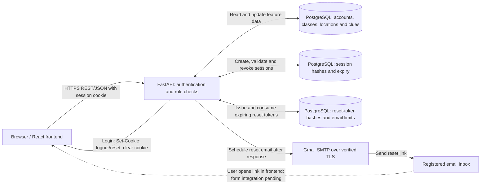

# Week 6 Team Log: Team 7

Authors: Ashish, Dan, Gamu, Madiba

October 12–18, 2026

## PRs covered

| PR | Author | What | Status |
|---|---|---|---|
| [#76](https://github.com/COSC-499-W2026/capstone-project-team-7/pull/76) | Ashish (nayakashish) | Teachers create classes with a language and class code | Merged |
| [#78](https://github.com/COSC-499-W2026/capstone-project-team-7/pull/78) | Ashish (nayakashish) | Teachers add students to their classes | Merged |
| [#80](https://github.com/COSC-499-W2026/capstone-project-team-7/pull/80) | Ashish (nayakashish) | Teachers remove students from their classes | Merged |
| [#81](https://github.com/COSC-499-W2026/capstone-project-team-7/pull/81) | Gamu (gamurrrrr) | Admins delete teacher accounts after class reassignment | Merged |
| [#82](https://github.com/COSC-499-W2026/capstone-project-team-7/pull/82) | Ashish (nayakashish) | Update the PR template and branch guidance | Merged |
| [#83](https://github.com/COSC-499-W2026/capstone-project-team-7/pull/83) | Gamu (gamurrrrr) | Admins delete student accounts | Merged |
| [#84](https://github.com/COSC-499-W2026/capstone-project-team-7/pull/84) | Gamu (gamurrrrr) | Admins create additional admin accounts | Merged |
| [#85](https://github.com/COSC-499-W2026/capstone-project-team-7/pull/85) | Gamu (gamurrrrr) | Admins enroll students in any class | Merged |
| [#88](https://github.com/COSC-499-W2026/capstone-project-team-7/pull/88) | Dan (danruk) | Shared Basic, Advanced, and Expert difficulty rules | Merged |
| [#89](https://github.com/COSC-499-W2026/capstone-project-team-7/pull/89) | Ashish (nayakashish) | Students join classes using a class code | Merged |
| [#90](https://github.com/COSC-499-W2026/capstone-project-team-7/pull/90) | Madiba (KoesOremus) | Revert a direct password-change push so it can receive PR review | Merged |
| [#92](https://github.com/COSC-499-W2026/capstone-project-team-7/pull/92) | Dan (danruk) | PostgreSQL storage for campus locations and translated clues | Merged |
| [#93](https://github.com/COSC-499-W2026/capstone-project-team-7/pull/93) | Madiba (KoesOremus) | Logged-in password changes and session revocation | Merged |
| [#95](https://github.com/COSC-499-W2026/capstone-project-team-7/pull/95) | Dan (danruk) | Reuse shared authentication in teacher endpoints | Merged |
| [#96](https://github.com/COSC-499-W2026/capstone-project-team-7/pull/96) | Madiba (KoesOremus) | Forgotten-password emails, hashed tokens, and resend limits | Merged |
| [#98](https://github.com/COSC-499-W2026/capstone-project-team-7/pull/98) | Madiba (KoesOremus) | Complete password resets and revoke existing sessions | Merged |

Merge status was checked against GitHub and refreshed `main` history. [#98](https://github.com/COSC-499-W2026/capstone-project-team-7/pull/98) merged on October 18, 2026 at 19:21 PDT as [`b350af3`](https://github.com/COSC-499-W2026/capstone-project-team-7/commit/b350af3fa51f3e1b2418a6471d80076c3ef72b00), which includes password changes, reset emails, and reset completion.

## Goal and work distribution

- Building on last week's account and authentication foundation, our goal was to extend class and account management and begin the data foundation for the scavenger hunt.
- Ashish implemented teacher class creation, enrollment and removal, and student self-enrollment by class code (#76, #78, #80, #89). He also updated the PR template and repository guidance for targeting `main` (#82).
- Gamu implemented admin deletion of teacher and student accounts, creation of additional admins, and enrollment of students into any class (#81, #83, #84, #85).
- Dan implemented shared difficulty rules, location and translated clue storage, and the shared-authentication refactor for teacher endpoints (#88, #92, #95).
- Madiba implemented logged-in password changes, forgotten-password email requests, and reset completion (#93, #96, #98). The reset flow validates the emailed token, changes the password, consumes the token, and revokes existing sessions.
- The merged backend now supports creating classes and managing their rosters through teacher, student, and admin workflows. Difficulty rules and clue storage provide foundations for game sessions; they do not yet constitute a running hunt.

## Code-base health

- **Shared authentication and validation.** Dan's #95 removes duplicated session handling from teacher class access and teacher approval. Protected routes reuse `auth.current_user` and role dependencies. Password changes and reset completion reuse password validation rather than maintaining different rules for each flow.
- **Authorization and data ownership.** Teacher enrollment and removal check class ownership before changing a roster. Student self-enrollment derives the student ID from the session. Admin endpoints restrict account operations by role, and teacher deletion is blocked while the teacher still owns classes.
- **Concurrent requests and transactions.** Enrollment uniqueness comes from the database, preventing duplicate rows under concurrent requests. Password changes lock the account and revoke sessions transactionally. Login uses a compatible row lock so an old-password login cannot create a surviving session during a password change. Reset completion also tests single-use token consumption and rollback on failure.
- **Password-reset privacy and abuse prevention.** Forgotten-password requests return the same message for registered, unknown, and rate-limited emails. Only token hashes are stored, links expire after 30 minutes, and persistent limits allow one email per minute and five per rolling hour. Consuming a token does not clear the hourly quota.
- **Schema and shared-file integration.** Location/clue storage and reset-token storage use new migrations. Router imports, README sections, migration numbering, and shared password helpers need checking when branches merge. A password-helper conflict should retain one shared validator, avoiding a duplicate definition.
- **Remaining cleanup.** Shared test fixtures are still imported between test modules; Gamu suggested moving them to `conftest.py` in a separate refactor. Repeated database-error handling is another possible follow-up, outside the feature PRs.

## Testing and validation

The test examples below are pinned to merged commit `b350af3`. The execution table links the full backend and frontend results for that same commit; the source links show what the tests assert.

| Area | Test evidence inspected | What the assertions establish |
|---|---|---|
| Teacher enrollment | [`test_teacher_enrolls_student_in_owned_class` and `test_already_enrolled_student_is_rejected`](https://github.com/COSC-499-W2026/capstone-project-team-7/blob/b350af3/tests/backend/test_class_enrollment.py) | A successful request writes the expected class/student pair; repeating it returns 409 and leaves one enrollment. Missing or unowned classes return 404 with no enrollment created. |
| Student removal and self-enrollment | [`test_teacher_removes_enrolled_student`](https://github.com/COSC-499-W2026/capstone-project-team-7/blob/b350af3/tests/backend/test_class_enrollment.py) and [`test_student_joins_class_with_code`](https://github.com/COSC-499-W2026/capstone-project-team-7/blob/b350af3/tests/backend/test_student_enrollment.py) | Removal deletes the enrollment while preserving the student and user rows. Joining by code persists an enrollment for the signed-in student; duplicate and expired-session cases check rejection and enrollment counts. |
| Teacher deletion | [`test_delete_after_reassign_keeps_student_data`](https://github.com/COSC-499-W2026/capstone-project-team-7/blob/b350af3/tests/backend/test_teacher_deletion.py) | Deletion returns 409 while the teacher owns a class. After reassignment it returns 204, the teacher account is absent, and the class's student enrollment remains. |
| Admin creation | [`test_new_admin_can_log_in`](https://github.com/COSC-499-W2026/capstone-project-team-7/blob/b350af3/tests/backend/test_admin_creation.py) | An existing admin creates an account through the endpoint; a duplicate returns 409; the new account logs in with the admin role. This checks the creation-to-login flow against PostgreSQL. |
| Location and clue storage | [`test_location_supports_multiple_language_clues` and `test_deleting_location_removes_its_clues_only`](https://github.com/COSC-499-W2026/capstone-project-team-7/blob/b350af3/tests/backend/test_database.py) | Stored translations can be read back. Deleting one location removes its clues while preserving another location's clues and the language records. These tests exercise storage, not hunt selection or audio. |
| Password changes | [`test_change_against_postgresql` and `test_session_delete_failure_rolls_back_password`](https://github.com/COSC-499-W2026/capstone-project-team-7/blob/b350af3/tests/backend/test_password_change.py) | Both existing browser sessions become unauthorized; the old password fails and the new one works. A forced session-deletion failure leaves the original password and session usable. |
| Reset email limits | [`test_hourly_cap_is_atomic_and_survives_token_consumption`](https://github.com/COSC-499-W2026/capstone-project-team-7/blob/b350af3/tests/backend/test_password_reset.py) | Concurrent requests compete for the fifth allowed email; deleting the token does not clear the quota; aging out an attempt permits another email. SMTP is mocked, so this does not prove inbox delivery. |
| Reset completion | [`test_concurrent_token_use_succeeds_once` and `test_failure_rolls_back_password_token_and_sessions`](https://github.com/COSC-499-W2026/capstone-project-team-7/blob/b350af3/tests/backend/test_password_reset_completion.py) | Concurrent submissions produce one success and one rejection. A forced database failure preserves the old password, reset token, and session; retrying after removing the failure succeeds. These tests are included in the merged backend CI run linked below. |

**Correction carried forward from Week 5.** Merged #45 does test teacher-signup persistence. At its merge commit, [`test_authorized_teacher_signup_persists_account`](https://github.com/COSC-499-W2026/capstone-project-team-7/blob/f0ef10635e794f5749797ee1c803c09a29213128/tests/backend/test_teacher_signup.py) submits the signup request, opens a separate PostgreSQL connection, reads both `users` and `teachers`, and verifies the saved details and bcrypt hash. The same file tests unauthorized signup creating no records and duplicate signup leaving one account. The earlier statement that automated persistence tests were absent was incorrect; this is existing Week 5 coverage, not a new Week 6 contribution.

**Execution evidence.** The push workflow for merge commit [`b350af3fa51f3e1b2418a6471d80076c3ef72b00`](https://github.com/COSC-499-W2026/capstone-project-team-7/commit/b350af3fa51f3e1b2418a6471d80076c3ef72b00) completed successfully on October 18, 2026 PDT (October 19 UTC). Counts below were checked in the job logs, including the pytest summary and Vitest result.

| Check | Environment and command | Result | Execution evidence |
|---|---|---|---|
| Full backend | Ubuntu, Python 3.13, PostgreSQL 17; migrations applied; both `DATABASE_URL` and `TEST_DATABASE_URL` configured; `python -m pytest tests/backend --html=test-results/report.html --self-contained-html` | **377 passed**, no skips reported; 111.88 seconds | [Backend job and log](https://github.com/COSC-499-W2026/capstone-project-team-7/actions/runs/39189612323/job/117859311303); downloadable `backend-test-results` report on the [run page](https://github.com/COSC-499-W2026/capstone-project-team-7/actions/runs/39189612323) |
| Frontend build and tests | Ubuntu, Node 22; `npm ci`, `npm run build`, `npm test` | **Build passed; 1 test passed** | [Frontend job and log](https://github.com/COSC-499-W2026/capstone-project-team-7/actions/runs/39189612323/job/117859311519) |

These results cover the integrated backend at the stated commit, including reset completion. The single frontend test does not establish a complete account or game journey. Frontend forms and the integrated hunt remain follow-up work. Automated email tests mock SMTP; Gmail accepting a separate test message does not independently confirm inbox receipt.

## Architecture and DFD alignment

Class creation and roster changes extend the Class Management process described in the DFD. FastAPI checks the signed-in user's role and, for teachers, class ownership before writing to PostgreSQL. Teacher enrollment, admin enrollment, and student self-enrollment all use the same `class_enrollments` table, so the roster remains consistent across entry points.

Admin account management extends the existing backend-managed authentication architecture. The initial admin still comes from the seed script; additional admins are created through an authenticated admin endpoint. Account deletion relies on database relationships to remove dependent records while preserving classes where required.

Password recovery connects the backend to Gmail SMTP over verified TLS. The backend stores a token hash and expiry, then schedules email delivery after the request response. Reset completion accepts the token and replacement password through the API and requires the user to log in again. Credentials remain in the ignored local `.env`.

The game foundation now includes shared difficulty definitions and location/clue storage. Basic exposes a room number, Advanced a number and description, and Expert a description. Translations are stored per location and language, while difficulty controls which content a future game presents. Campus data seeding, random location selection, audio, GPS, photos, and game-session behavior still need implementation.

The following Week 6 diagram replaces the Week 5 JWT-labelled diagram as this report's authentication reference. It shows the implemented backend session model and the browser integration that frontend forms will use. Login issues a Secure, HttpOnly, SameSite=Lax cookie; PostgreSQL stores its token hash and expiry, and protected requests validate it through `current_user`. Password changes and resets revoke the account's stored sessions.

The older PNG remains in the historical Week 5 materials; the session-cookie flow above documents the Week 6 implementation without carrying forward its JWT label.

## Collaboration process and next steps

The team moved PR targets from `dev` to `main` and updated the shared template and guidance. Feature work continued through small PRs with teammate review. A password-change commit pushed directly to `main` was reverted through #90 and reintroduced through the reviewed #93, restoring the intended review process.

Reviews produced concrete changes: Madiba's location-storage review led to UUID coverage and less brittle language-seed assertions; discussion between Ashish and Dan clarified the Advanced difficulty rules; and feedback on reset-email spam led to the persistent hourly cap. Dan's authentication refactor addressed duplicated session checks previously identified during review.

Next steps are to connect account and class APIs to frontend pages and begin game-session creation and clue selection. The team also needs campus locations and translations and browser-level verification of the combined account flows. Reset completion is merged and covered by the integrated backend CI run above. Future game progress must account for class-specific data cleanup when a student leaves a class.
